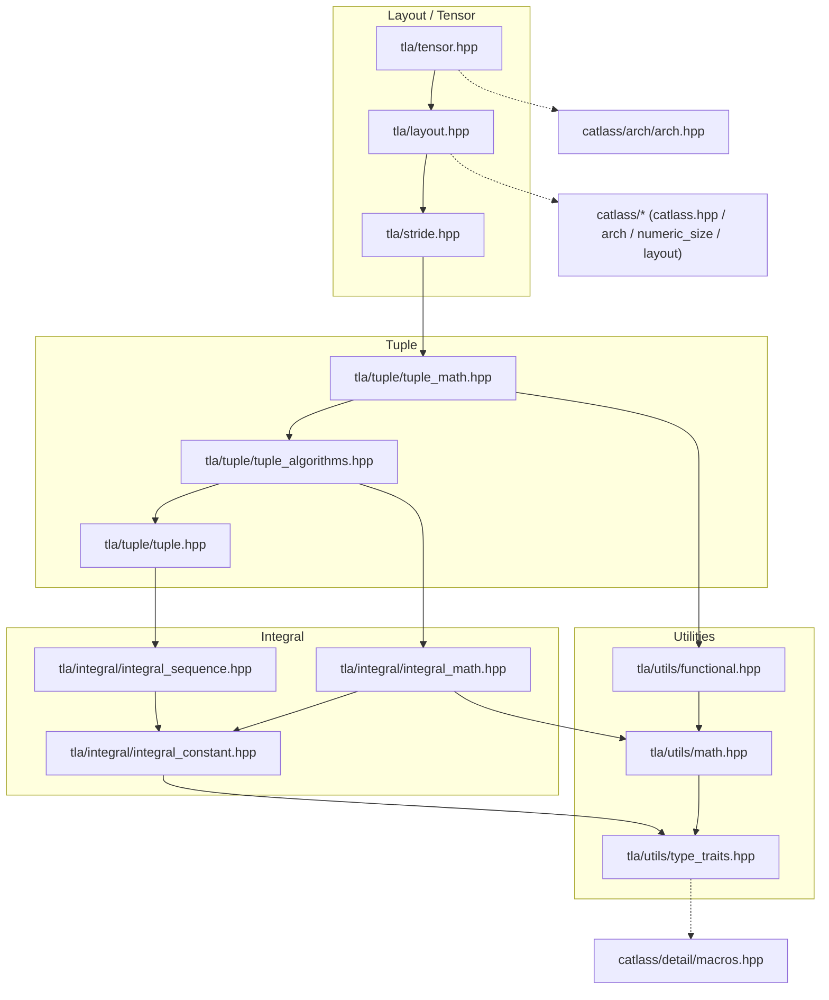

# TLA Module Architecture

This document describes the module boundaries, direct header dependencies, and public semantics of `include/tla/`. It complements [Layout](./01_layout.md), [LayoutTag](./02_layout_tag.md), and [Tensor](./03_tensor.md).

## Directory and layers

```text
include/tla/
├── utils/                    # type traits, scalar math, function objects
├── integral/                 # compile-time constants, sequences, arithmetic
├── tuple/                    # tla::tuple, tuple algorithms, tuple arithmetic
├── tuple.hpp                 # compatibility entry point for basic tuple types
├── stride.hpp                # compact strides and coordinate/index conversion
├── layout.hpp                # Layout, layout factories, and transformations
└── tensor.hpp                # Tensor views, slicing, and tile views
```

The conceptual dependency order is `utils` → `integral` → `tuple` → `stride` → `layout` → `tensor`. Top-level headers deliberately include several lower-level headers so that they remain convenient public entry points.

## Dependency graph

The graph is a transitive reduction: `A --> B` means that A is built on B. Direct `#include` details are listed below.



## Direct header dependencies

| Header | Direct TLA dependencies | Primary responsibility |
| --- | --- | --- |
| `utils/type_traits.hpp` | None | Type traits, forwarding, and tuple metadata wrappers. |
| `utils/math.hpp` | `utils/type_traits.hpp` | Scalar `max`, `min`, `clip_sub`, `ceil_div`, `round_up`, and `abs`. |
| `utils/functional.hpp` | `utils/type_traits.hpp`, `utils/math.hpp` | Function objects and `multiplies_unary_lfold`. |
| `integral/integral_constant.hpp` | `utils/type_traits.hpp` | `integral_constant<T, v>`, `C<v>`, `Int<v>`, `_`, and related traits. |
| `integral/integral_sequence.hpp` | `integral/integral_constant.hpp`, `utils/type_traits.hpp` | `IntegerSequence`, `make_*_sequence`, ranges, and reverse sequences. |
| `integral/integral_math.hpp` | `integral/integral_constant.hpp`, `utils/math.hpp`, `utils/type_traits.hpp` | Compile-time arithmetic and `conditional_return`. |
| `tuple/tuple.hpp` | integral constant/sequence and type traits | `tla::tuple`, `get`, and tuple traits. |
| `tuple/tuple_algorithms.hpp` | `tuple/tuple.hpp` and all integral headers | Selection, transformation, folding, flattening, and reconstruction. |
| `tuple/tuple_math.hpp` | tuple base/algorithms, required utils and integral headers | Integer-tuple arithmetic and aggregation. |
| `stride.hpp` | tuple headers, type traits, integral constant/sequence | Compact strides and coordinate/index conversion. |
| `layout.hpp` | `stride.hpp`, tuple headers, required utils/integral headers | `Layout`, factories, fractal layouts, and tile-layout helpers. |
| `tensor.hpp` | `layout.hpp`, required tuple/integral headers | `Tensor`, slicing, tile views, and `MakeTensorLike`. |

`layout.hpp` also directly includes CATLASS layout and architecture headers; `tensor.hpp` directly includes `catlass/arch/arch.hpp`. The utility, integral, tuple, and stride layers do not depend on CATLASS layout or architecture APIs.

## Public concepts

- `integral_constant<T, v>` is the fundamental static-value type. `C<v>` deduces its value type; `Bool`, `Int`, and `Int64` are convenience aliases.
- `constant<T, v>` and `bool_constant<b>` are aliases for `integral_constant<T, v>` and `Bool<b>`, respectively.
- `_` is an `Underscore` object for Tensor slicing, not a numeric constant.
- Aliases such as `_0`, `_1`, `_2`, `_16`, and `_64` are defined for the frequently used values listed in the source, along with their `long long` variants.
- `is_static<T>` is implemented as `is_empty<remove_cvref_t<T>>` and recognizes stateless types.
- `IntTuple` is a concept (an integral value or a recursively integral tuple), not a standalone type. Use `is_int_tuple` from `tuple/tuple_math.hpp` for its predicate.

The integer arithmetic layer preserves statically determined results, including some operations mixing constants with runtime integers. A result may therefore have a compile-time constant type. Explicitly convert it to an ordinary integer when a mutable accumulator is needed. See [TLA API: Constant evaluation and mutable results](../../3_API/include/tla/README.md#constant-evaluation-and-mutable-results) for an example.

`Layout<Shape, Stride, OriginShape>` stores these three tuple components and maps a coordinate to an element offset. `get`, `take`, and `select` project all three components together. `GetTileLayout` crops `originShape` for tail tiles; depth-1 layouts support any rank, while fractal layouts currently require rank 2.

`Tensor` binds an AscendC tensor, a TLA layout, a view coordinate, and a storage position. `GetTile` takes an element coordinate; `TileView` takes a tile coordinate. Both create views and perform no data movement. Slicing with `_` returns a projected view; fixed indices are not runtime bounds-checked.

## Include selection

- Use `tla/tuple.hpp` for basic tuple types; it forwards to `tla/tuple/tuple.hpp`. Also include `tla/tuple/tuple_algorithms.hpp` for structural transformations.
- Use `tla/integral/integral_constant.hpp` for compile-time constants.
- Also include `tla/integral/integral_sequence.hpp` or `tla/integral/integral_math.hpp` for integer sequences or compile-time arithmetic, respectively.
- Use `tla/tuple/tuple_math.hpp` for integer-tuple arithmetic and aggregation.
- Use `tla/stride.hpp` for coordinate/index conversion.
- Use `tla/layout.hpp` for layouts and layout factories.
- Use `tla/tensor.hpp` for Tensor views, slicing, and tile views.

For public entry points, lower-level headers, and replacements for old include paths, see [TLA API: Header selection](../../3_API/include/tla/README.md#header-selection).
