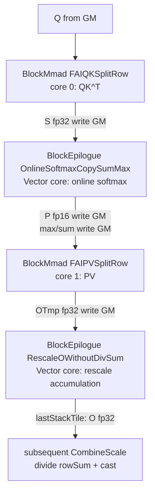

# FAI SplitRow Series Template Design Document

This document covers the 4 new templates of the Flash Attention inference (FAI) SplitRow series:

| Template | Type | Source file |
| ---- | ---- | ---- |
| `Gemm::MmadAtlasA2FAIQKSplitRow` | BlockMmad partial specialization | `include/catlass/gemm/block/block_mmad_fai_qk_split_row.hpp` |
| `Gemm::MmadAtlasA2FAIPVSplitRow` | BlockMmad partial specialization | `include/catlass/gemm/block/block_mmad_fai_pv_split_row.hpp` |
| `Epilogue::EpilogueAtlasA2OnlineSoftmaxCopySumMax` | BlockEpilogue partial specialization | `include/catlass/epilogue/block/block_epilogue_online_softmax_copy_glm.hpp` |
| `Epilogue::EpilogueAtlasA2RescaleOWithoutDivSum` | BlockEpilogue partial specialization | `include/catlass/epilogue/block/block_epilogue_rescale_o_no_div_rowsum.hpp` |

`EpilogueAscend950OnlineSoftmaxCopySumMax` is the Ascend950 specialization, which directly inherits the AtlasA2 implementation (`using Base::Base`) and is not expanded separately.

## Series Overview

The SplitRow series serves the **Shared FA inference kernel**: the QK GEMM and the PV GEMM belong to two Cube cores, while Softmax / RescaleO work as Vector epilogues on the data staged in GM, traversing an extra-long KV sequence through the outer stackTile loop. Compared with the Unshared series (which completes QK→softmax→PV within a single core), it offloads softmax to the Vector side so that the two Cube cores can each run MMAD at full load.



Key points of the four-template cooperation:

- QK SplitRow splits stackTiles along the N dimension (KV sequence length), producing one S matrix block per stackTile;
- OnlineSoftmaxCopySumMax performs online softmax on each S block, outputs P (for PV to consume) and maintains rowmax/rowsum across stackTiles, **writing the global max/sum back to GM only on the lastStackTile**;
- PV SplitRow preloads all of V, and after the softmax side is ready consumes P stackTile by stackTile, accumulating into the output OTmp;
- RescaleOWithoutDivSum uses `dm = exp(oldMax - newMax)` to rescale the historical accumulated result and accumulates the new OTmp, **outputting only the fp32 accumulated sum on the lastStackTile, without dividing by rowSum or casting**; normalization is left to the subsequent CombineScale epilogue.

## DispatchPolicy Definition

```cpp
// gemm/dispatch_policy.hpp
template <bool PAGED_CACHE_FLAG_ = false, bool ENABLE_UNIT_FLAG_ = false>
struct MmadAtlasA2FAIQKSplitRow {
    using ArchTag = Arch::AtlasA2;
    static constexpr bool PAGED_CACHE_FLAG = PAGED_CACHE_FLAG_;
    static constexpr bool ENABLE_UNIT_FLAG = ENABLE_UNIT_FLAG_;
};
template <bool PAGED_CACHE_FLAG_ = false, bool ENABLE_UNIT_FLAG_ = false>
struct MmadAtlasA2FAIPVSplitRow { /* same as above */ };

// epilogue/dispatch_policy.hpp
struct EpilogueAtlasA2OnlineSoftmaxCopySumMax { using ArchTag = Arch::AtlasA2; };
struct EpilogueAtlasA2RescaleOWithoutDivSum  { using ArchTag = Arch::AtlasA2; };
struct EpilogueAscend950OnlineSoftmaxCopySumMax { using ArchTag = Arch::Ascend950; };
```

Meaning of the template parameters:

- `PAGED_CACHE_FLAG`: whether the KV uses a blockTable paged cache (PagedAttention). When `true`, the KV offset is computed by looking up the table through `gBlockTable.GetValue(nowNIdx)`; when `false`, it is addressed contiguously as `nowNIdx * blockSize * strideKV`.
- `ENABLE_UNIT_FLAG`: reserved switch (all current examples pass `false`).

## BlockMmad FAIQKSplitRow: Q @ K^T

### Template Signature and Constraints

```cpp
template <bool PAGED_CACHE_FLAG_, bool ENABLE_UNIT_FLAG_,
          class L1TileShape_, class L0TileShape_, class A_, class B_, class C_>
class BlockMmad<MmadAtlasA2FAIQKSplitRow<PAGED_CACHE_FLAG_, ENABLE_UNIT_FLAG_>,
                L1TileShape_, L0TileShape_, A_, B_, C_>
```

static_assert constraints:

- `LayoutC` only supports `RowMajor` (the S matrix is written to GM by row for softmax to read by row);
- `N * K <= 32768` (the L1B double-buffer capacity limit, where K is the embedding dimension).

### Memory Layout

| Buffer | Size | Organization |
| ---- | ---- | ---- |
| L1A | `M * K * sizeof(A)` | Single buffer, Q resides permanently in one transfer |
| L1B | `32768 * sizeof(B)` | Double buffer (pingpong), KV flows in by stackTile |

Q is transferred once through `loadQGM()`, using the extended signature `copyGmToL1A`, which carries the `tokenNumPerGroup / qHeads * embed / BLOCK_SIZE` parameters to implement **GQA grouped transfer** (`layoutA.GetTileLayout(MakeCoord(singleGroupHeads, embed))`), that is, rearranging the data by "each group of Q heads" to avoid initiating multiple transfers head by head. Event ID `EVENT_ID3`.

### Main Loop and Pipeline

The three-level loop structure of `operator()`:

```
nL1Loop  split stackSeqTile by L1TileShape::N (last round getBlockShape takes the remainder)
 └─ mL0Loop  split row blocks by L0TileShape::M
     └─ kL0Loop  split the K dimension by L0TileShape::K
         └─ tileMmad(initMmad = (kL0Idx == 0))
```

- Each outer iteration calls `getKVOffset(nowNIdx)`: in paged mode it looks up the blockId in the blockTable and then computes an offset such as `blockId * blockSize * strideKV`; in contiguous mode it addresses linearly.
- Three pingpong event groups support the full pipeline:
  - `l1KPPingPongFlag`: `MTE1_MTE2 / MTE2_MTE1`, controlling the loading and consumption of the KV in L1B;
  - `l0ABPingPongFlag`: `M_MTE1 / MTE1_M`, controlling the loading of L0A/L0B and the MMAD consumption;
  - `l0CPingPongFlag`: `M_FIX / FIX_M`, controlling the writing of the L0C result to GM through FixPipe and the overwrite in the next round.
- The `initMmad` flag of `tileMmad` ensures that L0C is initialized on the first accumulation of the K dimension and accumulated afterwards.

## BlockMmad FAIPVSplitRow: P @ V

### Template Signature and Constraints

```cpp
template <...same as above...>
class BlockMmad<MmadAtlasA2FAIPVSplitRow<PAGED_CACHE_FLAG_, ENABLE_UNIT_FLAG_>, ...>
```

static_assert: `M * K <= 32768` (the L1A double-buffer capacity limit).

### Memory Layout

| Buffer | Size | Organization |
| ---- | ---- | ---- |
| L1A | `32768 * sizeof(A)` | Double buffer, offset `l1BufAddrStart + L1A_SIZE * i`, P flows in by block |
| L1B | `N * K * sizeof(B)` | Single buffer (all of V resides permanently in one transfer), offset `l1BufAddrStart + L1A_SIZE * 2` |

### Execution Timing (Core Design)

```
1. kLoop = CeilDiv(stackSeqTile, blockSize)
   └─ loop moves all of V into L1B by block page (look up blockTable when paged), event EVENT_ID2
2. Arch::CrossCoreWaitFlag(softmaxFlag)
   └─ cross-core wait: the softmax core has produced a usable P (GM staging)
3. mL1Loop × kL1Loop × kL0Loop
   └─ move P into L1A (pingpong) → MMAD accumulation (initMmad = (kL1Idx==0 && kL0Idx==0))
4. output OTmp (fp32) to GM
5. SetFlag(MTE1_MTE2, EVENT_ID2)
   └─ release the V transfer channel after finishing, for reuse by the next stackTile
```

Compared with the three pingpong groups of QK, the synchronization focus on the PV side is **V before P**: the V preload can proceed ahead of the softmax completion, and `CrossCoreWaitFlag` only blocks the P consumption path, so the V loading time is fully hidden.

## BlockEpilogue OnlineSoftmaxCopySumMax: Online Softmax

### Template Signature

```cpp
template <class OutputType_, class InputType_, class MaskType_>
class BlockEpilogue<EpilogueAtlasA2OnlineSoftmaxCopySumMax, OutputType_, InputType_, MaskType_>
```

- `OutputType_`: the P matrix type (fp16/bf16, consumed by the PV GEMM);
- `InputType_`: the S matrix type (fp32, from the QK GEMM);
- `MaskType_`: the attention mask type, supporting both the `NO_MASK` and the regular mask path.

The constructor signature is `BlockEpilogue(resource, scaleValue_)`, where `scaleValue_` is the `1/sqrt(d)` scaling factor applied before softmax.

### UB Layout

Organized by `UB_UINT8_BLOCK_SIZE` (16384-byte blocks), with the key offsets:

| Tensor | UB offset | Description |
| ---- | ---- | ---- |
| ls (current S value) | `0` | scale·S of the current stackTile, fp32, capacity `MAX_UB_S_ELEM_NUM = 8192` |
| lp (P output) / mask32 | `4 * block` | shares space with the 32-bit view of mask |
| tmp (tv) | `10 * block` | reduction intermediate |
| lm / hm | `10 * block + 8/9 * vec` | row maximum of the current round / global row maximum |
| gm / ll / gl / dm | `10 * block + 10~13 * vec` | global max, row sum of the current round, global row sum, rescale coefficient |
| mask | `11 * block` | raw mask data |

The adjacent row sum / row maximum use a pingpong layout (`ROW_SUM_PINGPONG_OFFSET = 64 * 8`), cooperating with the row block loop to hide the MTE2 loading. `MAX_ROW_NUM_SUB_CORE = 128` limits the maximum number of rows handled by a single SubBlock.

### Online Softmax Recurrence

For each stackTile, the global `gm` (max) and `gl` (sum) are maintained per row:

```
lm = rowmax(scale · S)                  // row maximum of this tile
hm = isFirst ? lm : max(lm, gm)         // update the global maximum
dm = isFirst ? 1 : exp(gm - hm)         // historical scaling coefficient
ls = exp(ls - hm)                       // numerically stable exponential
ll = rowsum(ls)                         // row sum of this tile
gl = isFirst ? ll : dm * gl + ll        // rescale accumulation
gm = hm
```

On `isLastStackTile`: `gm`/`gl` are output to `gSharedMax`/`gSharedSum` through `Brcb` expansion + `DataCopy(rowNum, 1, 0, headNum - 1)` (strided write), for use by RescaleO and the subsequent CombineScale. During non-last tiles, max/sum only rotate within UB/registers and generate no GM traffic.

### Three Branches of Row Reduction

`Rowmax`/`Rowsum` are implemented in three tiers according to `columnNum` (the stackTile sequence length):

| Branch | Condition | Approach |
| ---- | ---- | ---- |
| `SPECTILE512` | columnNum == 512 | 3 cascaded `BlockReduceMax/Sum` |
| `SPECTILE256` | columnNum == 256 | `SetVecMask(32)` + `SetBlockReduceMask(4)` |
| `TAILTILE` | otherwise | whole-vector loop over 64 elements + `SetVecMask` masking of the tail |

### Reduced-Precision Output of P

In `CalcExp`, `hm` is broadcast to the whole row through `Brcb` before `exp` is computed; then `DownCastP` converts the fp32 P to fp16 (`CAST_NONE`) or bf16 (`CAST_RINT`, to avoid overflow), and `CopyPUbToGm` writes it to GM. Choosing RINT rounding in the bf16 scenario is a key point for precision.

### SubBlock Splitting and Prefetch Pipeline

`operator()` splits the row dimension in half between the two SubBlocks (`qSBlockSize / 2` when `qNBlockSize == 1`; otherwise scaled up by the qN multiplier). The row direction is further blocked by `maxRowNumPerLoop` (converted from the 8192-element capacity), with pingpong prefetch `preLoad = 1`: while block i is computed, the S of block i+1 is prefetched. The event family `V_MTE2 / MTE2_V / V_MTE3 / MTE3_V` (HardEvent) guarantees the three-level pipeline of transfer, computation, and write-out.

## BlockEpilogue RescaleOWithoutDivSum: O Accumulation

### Template Signature

```cpp
template <class OutputType_, class InputType_, class UpdateType_>
class BlockEpilogue<EpilogueAtlasA2RescaleOWithoutDivSum, OutputType_, InputType_, UpdateType_>
```

Typical instantiation: `OutputType_ = fp16`, `InputType_ = fp32` (OTmp), `UpdateType_ = fp32`. The constructor takes only `resource` and has no additional parameters.

### UB Layout and Shared Design

| Tensor | UB offset |
| ---- | ---- |
| lo (OTmp of the current round) | `6 * block` |
| go (accumulated O) | `8 * block`, `goUbTensor16/goUbTensor32` are two views at the same address |
| tmp | `10 * block` |
| hm / gl / dm | `10 * block + 9/12/13 * vec` |

Note that the hm/gl/dm offsets are **exactly the same** as the layout of the OnlineSoftmax epilogue — the two run at different stages of the same kernel and reuse the same UB plan, avoiding layout conflicts across epilogues. `MAX_UB_O_ELEM_NUM = 4096` limits the number of rows × columns of a single block.

### Core Algorithm

```
WaitFlag(V_MTE2, EVENT_ID3)        // wait until OTmp is readable (handshake with the PV GEMM)
if (isFirstStackTile):
    go = lo                          // the first block is placed directly
else:
    lo = GM -> UB (the accumulated result of the previous stackTile)
    dm[curStackTileMod * 128] is broadcast to dm_block through Brcb
    go = go * dm_block               // segment-wise Mul with FLOAT_VECTOR_SIZE=64
    go = go + lo                     // accumulation
SetFlag(V_MTE2, EVENT_ID3)          // release the handshake
if (isLastStackTile):
    CopyFloatOToGm -> gSharedOut     // float output directly, no division by rowSum, no cast
```

- `EVENT_ID3` (the `V_MTE2` event pair) is the **cross-module handshake signal** between this epilogue and the data producer; `EVENT_ID0` is the internal MTE2↔V synchronization.
- Inside `CopyFloatOToGm`, a single-block `DataCopyPad` is used when `qNBlockSize == 0`; otherwise the output proceeds qN block by qN block.
- The last tile **does not perform `O / rowSum` and does not perform the fp32→fp16 cast** — the division and precision reduction are uniformly deferred to the downstream CombineScale epilogue and completed in one go, reducing intermediate precision loss and the number of GM reads and writes.

### SubBlock Splitting

Unlike the row halving of OnlineSoftmax, this epilogue adapts along the qN dimension: when `qNBlockSize == 1`, the two SubBlocks split the rows; when `qNBlockSize > 1`, they split the columns (halving outCol), while inRow is scaled up as a whole by the qN multiplier. The split dimension is aligned with the GM arrangement of the data (when qN is expanded along the row dimension, the rows are contiguous), ensuring that the transfer of each SubBlock is a contiguous segment.

## Usage Example

### Real Engineering Assembly (xllm_ops x_attention)

Excerpted from `CallSharedInferKernelShort` in `x_attention/op_kernel/x_attention_catlass_helper.h` of xllm_ops (https://gitcode.com/xLLM-AI/xllm_ops):

```cpp
using INPUT_T = ...;                 // element type of Q/K/V/P/O and mask (for example fp16)
using L0TileShape = GemmShape<16, 16, 16>;

using L1TileShapeQK = GemmShape<128, 128, 128>;   // L1TileShape::K must be embedding
using DispatchPolicyQK = Gemm::MmadAtlasA2FAIQKSplitRow<isPAEnabled, false>;
using BlockMmadQK = Gemm::Block::BlockMmad<DispatchPolicyQK, L1TileShapeQK,
                                           L0TileShape, QType, KType, SType>;
using DispatchPolicyOnlineSoftmax = Epilogue::EpilogueAtlasA2OnlineSoftmaxCopySumMax;
using EpilogueOnlineSoftmax = Epilogue::Block::BlockEpilogue<
    DispatchPolicyOnlineSoftmax, PType, SType, maskType>;
// update rowsum rowmax and copyOut on lastStackTile

using L1TileShapePV = GemmShape<128, 128, 128>;
using DispatchPolicyPV = Gemm::MmadAtlasA2FAIPVSplitRow<isPAEnabled, false>;
using BlockMmadPV = Gemm::Block::BlockMmad<DispatchPolicyPV, L1TileShapePV,
                                           L0TileShape, PType, VType, OTmpType>;
using DispatchPolicyRescaleO = Epilogue::EpilogueAtlasA2RescaleOWithoutDivSum;
using EpilogueRescaleO = Epilogue::Block::BlockEpilogue<
    DispatchPolicyRescaleO, OType, OTmpType, OUpdateType>;
// do not div rowSum or cast on lastStackTile

using SharedFAInferKernel = SharedFAInferKernelShort<
    BlockMmadQK, BlockMmadPV, EpilogueOnlineSoftmax, EpilogueRescaleO, isPAEnabled>;
SharedFAInferKernel kernel(...);
kernel();   // inside the outer stackTile loop, the kernel drives the four templates in order
```

Key points of the assembly:

1. **`L1TileShape::K` must equal the embedding dimension** (128); the K of both QK and PV is "contraction dimension = embedding";
2. The C type of QK (SType) is fp32 (`LayoutC = RowMajor`), and the C type of PV is the fp32 OTmp;
3. `isPAEnabled` is passed through directly to the `PAGED_CACHE_FLAG` of both BlockMmad templates, and the blockTable pointer is passed in with the kernel parameters;
4. The Mask type is passed to the OnlineSoftmax epilogue through `maskType`, and the no-mask fast path is taken when it is `NO_MASK`.

### In-Repository Test

`tests/optest/kernels/23_flash_attention_infer/flash_attention_infer.cpp:741-768` provides a complete call example for the SplitRow path (construction, parameter passing, launch), which can corroborate the assembly code above.

## Differences from the FA Unshared Series

| Dimension | FAI SplitRow (this document) | FA Unshared (see document 01) |
| ---- | ---- | ---- |
| Core topology | two Cube cores for QK and PV + Vector epilogue | QK→softmax→PV within a single Cube core |
| S/P data path | staged through GM, each module with its own pingpong | direct L0C/UB connection within the core, no GM round trip |
| Long sequence handling | outer stackTile loop, naturally supports extra-long KV | a single fixed tile per round, sequence length constrained by L1 |
| softmax location | dedicated epilogue core, OnlineSoftmax-style | `EpilogueAtlasA2FAUnsharedSoftmax` single-pass softmax |
| Normalization timing | RescaleO does not divide by sum, deferred to CombineScale | completed directly within the core |
| Applicable scenario | long-sequence / PagedAttention inference | inference with short sequences that fit entirely in a tile |

Selection guidance: choose SplitRow when the KV sequence length exceeds the L1 capacity of a single core (`N * K > 32768`) or when paged KV is required; when the sequence is short and fits entirely, the in-core direct connection of Unshared saves more GM bandwidth.
