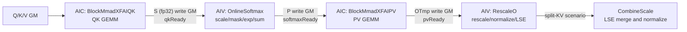

# XFAI Kernel Design (Atlas A2 Inference Flash Attention)

## Series Overview

The XFAI (X Flash Attention Infer) series targets the Flash Attention operator in the **Atlas A2 (DaVinci C220) inference scenario**. Like the [FAI SplitRow series](./02_fai_split_row_kernel.md), it belongs to the "AIC computes, AIV reduces" cross-core pipeline form, but its template organization is more strongly encapsulated:

- **The two GEMM segments, QK and PV, are each an independent `BlockMmad` template**, and the intermediate `S`/`P` matrices are staged through GM;
- **Online Softmax and RescaleO are `BlockEpilogue` partial specialization templates**, and RescaleO introduces the independent `UpdateType_`/`LseType_` type parameters;
- **Native support for Paged KV Cache** (the `PAGED_CACHE_FLAG_` policy parameter, which can be enabled on either the QK or the PV side);
- **An independent `CombineScale` template class** is provided for LSE merge-normalization of multiple local split-KV results.

### Template List

| Template | Policy (DispatchPolicy) | Location |
| --- | --- | --- |
| BlockMmadXFAIQK | `MmadAtlasA2XFAIQK<PAGED_CACHE_FLAG_, ENABLE_UNIT_FLAG_>` | `include/catlass/gemm/block/block_mmad_xfai_qk.hpp` |
| BlockMmadXFAIPV | `MmadAtlasA2XFAIPV<PAGED_CACHE_FLAG_, ENABLE_UNIT_FLAG_>` | `include/catlass/gemm/block/block_mmad_xfai_pv.hpp` |
| BlockEpilogueXFAIOnlineSoftmax | `EpilogueAtlasA2XFAIOnlineSoftmax<LSE_MODE_>` | `include/catlass/epilogue/block/block_epilogue_xfai_online_softmax.hpp` |
| BlockEpilogueXFAIRescaleO | `EpilogueAtlasA2XFAIRescaleO<LSE_MODE_>` | `include/catlass/epilogue/block/block_epilogue_xfai_rescale_o.hpp` |
| CombineScale | `CombineScale<OutputType_, LseType_>` (independent class, not a BlockEpilogue specialization) | `include/catlass/epilogue/block/block_epilogue_xfai_combine_scale.hpp` |

### Cross-Core Pipeline Overview



Core idea: the CUBE core handles the two GEMM segments QK and PV, while the Vector core handles softmax and rescale; the `preLoad=1` software pipeline makes QK lead PV by one stackTile, and the two pingpong groups hide the GM staging overhead.

## DispatchPolicy Definition

GEMM side (`include/catlass/gemm/dispatch_policy.hpp:175-187`):

```cpp
// QK GEMM policy for inference Flash Attention
template <bool PAGED_CACHE_FLAG_ = false, bool ENABLE_UNIT_FLAG_ = false>
struct MmadAtlasA2XFAIQK : public MmadAtlasA2 {
    using ArchTag = AtlasA2;
    static constexpr uint32_t STAGES = 2;               // two-level L1/L0 pingpong
    static constexpr bool PAGED_CACHE_FLAG = PAGED_CACHE_FLAG_;
    static constexpr bool ENABLE_UNIT_FLAG = ENABLE_UNIT_FLAG_;
};

// PV GEMM policy for inference Flash Attention (template parameters as above)
template <bool PAGED_CACHE_FLAG_ = false, bool ENABLE_UNIT_FLAG_ = false>
struct MmadAtlasA2XFAIPV : public MmadAtlasA2 { ... };
```

Epilogue side (`include/catlass/epilogue/dispatch_policy.hpp:283-306`):

```cpp
// Online Softmax policy, LSE_MODE_ controls the logsumexp output behavior
template <bool LSE_MODE_ = false>
struct EpilogueAtlasA2XFAIOnlineSoftmax {
    using ArchTag = AtlasA2;
    static constexpr bool LSE_MODE = LSE_MODE_;
};

// RescaleO policy, template parameter meaning as above
template <bool LSE_MODE_ = false>
struct EpilogueAtlasA2XFAIRescaleO { ... };
```

## BlockMmadXFAIQK — QK GEMM Design

**Class form** (`block_mmad_xfai_qk.hpp:32`):

```cpp
template <typename DispatchPolicy, typename L1TileShape_, typename L0TileShape_,
          typename AType_, typename BType_, typename CType_>
class BlockMmad<MmadAtlasA2XFAIQK<PAGED_CACHE_FLAG_, ENABLE_UNIT_FLAG_>,
                L1TileShape_, L0TileShape_, AType_, BType_, CType_> { ... };
```

### Key Constants and Storage Layout

| Constant | Value | Meaning |
| --- | --- | --- |
| BLOCK_SIZE | 16 | KV paging base block (granularity of head-dimension blocking) |
| EMBED_SPLIT_SIZE | 128 | size of a single block along the embed dimension |
| UNIT_BLOCK_STACK_NUM | 4 | number of unit blocks pushed per stack |
| KV_BASE_BLOCK | 512 | KV cache paging base block |
| KV_SPLIT_SIZE | 128 | KV split granularity |

- Constructor: `BlockMmad(resource, nDyn, kDyn, l1BufAddrStart = 0)`. The Q matrix **resides permanently in L1A after a single copy** (`l1ATensor` starts at `l1BufAddrStart`), while B (K) and L0A/L0B/L0C use a two-level pingpong with `STAGES=2` — this layout is the precondition for PV and QK **sharing the same CUBE core L1 space** (the B area of PV follows immediately after the area occupied by QK).
- The output C (that is, the S matrix) is written directly from L0C to GM by `copyL0CToGm` for the AIV side to consume.

### Grouped Loading of Q: loadQGM

```cpp
void loadQGM(const GlobalTensor<AType>& gA, const LayoutA& layoutA,
             uint32_t rowNum, uint32_t singleGroupHeads, uint32_t qHeads);
```

Q is loaded in head groups: `tokenNumPerGroup = rowNum / singleGroupHeads`, groups are reached through offset jumps, and one MTE2→MTE1 transfer brings a whole group into L1A (`EVENT_ID3` synchronization). The purpose of grouping is to let the same copy of Q serve loop reuse across multiple KV splits.

### Paged Addressing: getKVOffset

The KV offset takes two paths according to `PAGED_CACHE_FLAG_`:

- **Paged path**: look up `gBlockTable`, with `kOffset = blockTableId * KV_BASE_BLOCK * strideKV + ...`, supporting sparse paging of the KV cache;
- **Non-paged path**: contiguous addressing directly as `nowNIdx * BLOCK_SIZE * strideKV`.

### Main Loop: Three-Level Pingpong

Inside `operator()` there is an nL1×mL0×kL0 three-level loop: the nL1 level splits KV split blocks by `stackSeqTile` using `l1NDynamic`; the three pingpong groups `l1KvPingPongFlag` (L1 B area), `l0ABPingPongFlag` (L0A/L0B), and `l0CPingPongFlag` (L0C) toggle independently, fully overlapping the three segments "load K / compute QK / write back S". After S is written to GM, the caller sets the `qkReady` cross-core flag to notify AIV.

## BlockMmadXFAIPV — PV GEMM Design

**Class form** (`block_mmad_xfai_pv.hpp`): the partial specialization signature is the same as QK, only the Policy is changed to `MmadAtlasA2XFAIPV`.

### L1 Layout and Construction

```cpp
BlockMmad(resource, nDyn, kDyn, l1BufAddrStart);
// internally: l1B is placed at l1BufAddrStart + M * kDyn * sizeof(A) * 2
```

PV and QK share the L1 of the CUBE core: the B (V) area of PV follows immediately after the permanent Q area of QK. The V area is loaded in a single copy, while the P area (`l1ATensor[STAGES]`) is double buffered.

### operator() and Cross-Core Gating

```cpp
// excerpt of the call signature
blockMmadPV(gP, gV, gOTmp, ..., blockStackNum, /* Arch::CrossCoreFlag */ softmaxFlag,
            nIdx, nLoop /* reference out-params: current block index and total block count */);
```

Execution order:

1. **Batch load of V**: prefetch the V of `blockStackNum` KV blocks into L1 in one go (`EVENT_ID4` + `EVENT_ID0` synchronization), for reuse by the PV of several subsequent stackTiles;
2. **Cross-core wait**: `CrossCoreWaitFlag(softmaxFlag)` — blocks until the AIV side Online Softmax has written the P of the current block to GM. This is the key gate that links the "QK → softmax → PV" pipeline;
3. **P streaming pingpong**: in the main loop nL1×mL1×kL1×kL0, P flows from GM into L1A in pingpong fashion via `l1PPingPongFlag`, with `LOAB_BLOCK = 1`;
4. **PV direct write to GM**: the intermediate result O (OTmp) is written directly from L0C to GM, and the trailing `SetFlag` (MTE1_MTE2, `EVENT_ID4`) lets the AIV side RescaleO align.

## BlockEpilogueXFAIOnlineSoftmax Design

**Class form** (`block_epilogue_xfai_online_softmax.hpp:25`):

```cpp
template <typename OutputType_, typename InputType_, typename MaskType_>
class BlockEpilogue<EpilogueAtlasA2XFAIOnlineSoftmax<LSE_MODE_>,
                    OutputType_, InputType_, MaskType_> { ... };
// OutputType_ = P (the type passed down to PV), InputType_ = S (fp32), MaskType_ is generally int8_t
```

Constructor: `BlockEpilogue(resource, scaleValue)`, where `scaleValue` is the `1/sqrt(d)` scaling factor.

### UB Layout

| Buffer | Specification | Purpose |
| --- | --- | --- |
| lsUbTensor | 8192 elements pingpong | S matrix (fp32), double buffered to cooperate with the preLoad pipeline |
| lpUbTensor | same as ls | P matrix (after downcast) |
| maskUbTensor / mask16 / mask32 | three levels | raw/16-bit/32-bit views of the token mask |
| lm / hm / gm / dm | row vector scalars | local max / expanded max / global max / dm=exp(gm-hm) |
| ll / gl | row vector scalars | local sum / global sum |
| tv | row vector scalars | broadcast staging (for LSE output) |

### Three-Way Dispatch of Rowsum / Rowmax

Three reduction specializations are dispatched according to the column width of the current block: **SPECTILE512** / **SPECTILE256** / **TAILTILE**. The first two use whole-block `BlockReduceSum/Max` for aligned column widths (with `SetVecMask`/`SetBlockReduceMask`), while TAILTILE handles unaligned columns of the tail block, ensuring correct cross-block row-max / row-sum semantics.

### Online Softmax Core Flow

```
CopySGmToUb                // S from GM into UB
ScaleS                     // S *= scaleValue
[ApplyMask]                // optional: add mask32 * (-3e38) to S to implement masking
CalcLocalRowMax            // lm = rowmax(S)
UpdateGlobalRowMax         // hm = max(lm, gm); dm = exp(gm - hm); gm ← hm
CalcExp                    // ls = exp(ls - hm)   (Brcb row-broadcasts hm)
DownCastP                  // fp32 → OutputType_ (bf16 uses the CAST_RINT rounding strategy)
CopyPUbToGm                // P is written directly to GM for the AIC side PV to consume
CalcLocalRowSum            // ll = rowsum(P)
UpdateGlobalRowSum         // gl = dm * gl + ll
```

`dm = exp(gm_old - gm_new)` is the decay factor by which the previous round of P must be multiplied as a whole, and it is handed to RescaleO — this is the classic Flash Attention online softmax recurrence.

### Two operator() Overloads: Without Mask and With Mask

```cpp
// version without mask (excerpt of parameters)
epilogueOnlineSoftmax(gS, gP, layoutS, layoutP, ..., stackSeqTile);

// version with mask (causal / token mask, 13 parameters, excerpt of parameters)
epilogueOnlineSoftmax(gS, gP, gMask, layouts..., qkReady,
                      triUp, triDown, kvSStartIdx, kvSEndIdx, ...);
```

Key points of the version with mask:

- The entry first does `CrossCoreWaitFlag(qkReady)` to wait for the S on the AIC side to be ready;
- The mask is copied in three row segments (proTokenNum / integralHeadNum / epiTokenNum), adapting to the token-level compressed layout;
- `triUp/triDown` describe the upper and lower bounds of the causal triangle; together with `kvSStartIdx/kvSEndIdx` they determine whether the current KV block can be skipped entirely or must be partially masked;
- When `LSE_MODE == LSE_OUT`, the last block uses the `tv` buffer to write out the LSE row values.

### SubBlock Splitting and Pipeline

- When `qNBlockSize == 1` (one row of Q per subBlock), the rows are split in half between the two subBlocks for parallel processing;
- `preLoad = 1`: the GM read of S overlaps with the softmax computation of the previous block, hiding the transfer latency.

## BlockEpilogueXFAIRescaleO Design

**Class form** (`block_epilogue_xfai_rescale_o.hpp`): five type parameters, which is the extension point of this series relative to the base class template:

```cpp
template <typename OutputType_, typename InputType_, typename UpdateType_, typename LseType_>
class BlockEpilogue<EpilogueAtlasA2XFAIRescaleO<LSE_MODE_>, OutputType_, InputType_, UpdateType_, LseType_>;
// OutputType_ = O (final output), InputType_ = OTmp (PV accumulation result),
// UpdateType_ = intermediate round write-back type (fp32), LseType_ = LSE output type
```

Constructor: `BlockEpilogue(resource)`.

### Core Algorithm: Fusing New and Old O

```
lo  = gInput[current block]          // read the previous round of O (or read OTmp directly on the first round)
go  = gUpdate * dm_block + lo        // dm is row-broadcast via Brcb; that is, O_new = exp(gm_old-gm_new)*O_old + PV_cur
if (!isLastStackTile):
    go → write back to gUpdate (fp32 intermediate, for the needRowLoop scenario)
else:
    go = go / gl_block               // normalize by the global row sum on the last block
    go → downcast → CopyOToGm        // write the final O in three token segments pro/integral/epi
    if (LSE_MODE == LSE_OUT):
        lse = ln(gl) + gm            // write gLse with DataCopyPad after Brcb row broadcast
```

Key points:

- **First block passthrough**: the first stackTile has no old O to multiply, so `go = lo` enters the accumulation directly;
- **Last block normalization**: divide by the global row sum `gl` to complete the softmax denominator normalization, then downcast and write GM in three token segments (pro/integral/epi), compatible with variable-length seq;
- **LSE output**: `lse = ln(gl) + gm`; together with the gm/gl passed from the OnlineSoftmax side, the logsumexp is obtained in one go on the last block;
- **Event system**: `EVENT_ID0/1/3/5/6` manage multi-level synchronization of GM reads, broadcasts, and writes.

## CombineScale Design (split-KV Merge)

**Class form** (`block_epilogue_xfai_combine_scale.hpp`): an independent template class that is **not** a partial specialization of `BlockEpilogue`, because it consumes "multiple local results" rather than a single tile:

```cpp
template <typename OutputType_, typename LseType_>
class CombineScale { ... };
```

### operator() Signature

```cpp
void operator()(uint32_t qHeads, uint32_t kvSplitCoreNum, uint32_t headSizeV,
                __gm__ SplitKvExtraInfo* extraInfo,
                GlobalTensor lGmTensor,        // LSE of each split (local)
                GlobalTensor oCoreTmpGmTensor, // O of each split (local, unnormalized)
                GlobalTensor oGmTensor,        // final O after merging
                GlobalTensor gActualQseqlen, bool inputLayoutTND = true);
```

Task traversal: `for (process = subBlockID; process < kvSplitCoreNum * 2; process += subBlockNum)`, parsing batchIdx/headStartIdx/headEndIdx/qStartIdx/qEndIdx/splitNum and the LSE/O task offsets from `extraInfo->splitInfo`.

### LSE Merge Algorithm

For each q row, merge the splitNum local LSE values (denoted `ll[n]`) into a global value:

```
lm = ReduceMax(ll)                  // the maximum of the local maxima of all splits
tl = exp(ll - lm)                   // shift to prevent overflow
rs = Ln(ReduceSum(tl))              // the core step of log-sum-exp
ts = rs + lm                        // final LSE
gl = exp(ll - ts)                   // final scaling coefficient of each split
```

### O Merge

```
O_final = Σ_n O_n * gl[n]           // BroadCast + Mul + Add loop, loFloat pingpong accumulation
```

`toUbTensor` and `broadCastOTensor` share the UB space (staggered in time) to save UB. Implementation details:

- **TND layout**: compute the q row offset of each batch from the `prevQSeqlenSum` prefix sum;
- **q_len == 1 specialization**: in the decode scenario the two half subBlocks are addressed independently;
- **Alignment**: `splitNumAlign` / LSE blocks are aligned to 8 elements (32-bit semantics) to avoid the DataCopy alignment restriction.

## Cross-Core Synchronization Chain and Software Pipeline

The caller (kernel layer) holds three `Arch::CrossCoreFlag` objects:

| Flag | Producer | Consumer | Meaning |
| --- | --- | --- | --- |
| qkReady | AIC (QK, PIPE_FIX) | AIV (OnlineSoftmax with mask) | the S of the current block has been written to GM |
| softmaxReady | AIV (Softmax, PIPE_MTE3) | AIC (WaitFlag inside PV) | the P of the current block has been written to GM |
| pvReady | AIC (PV, PIPE_FIX) | AIV (RescaleO) | the OTmp of the current block has been written to GM |

The outer loop drives the software pipeline with `kvSIdx ∈ [0, kvSLoopNumTotal + preKVNum)`: when `kvSIdx < kvSLoopNumTotal`, QK+Softmax is executed; when `kvSIdx >= preKVNum`, PV+RescaleO is executed (`nowkvSIdx = kvSIdx - preKVNum`), making QK lead PV by one stackTile and realizing the three-way overlap of "load-compute-cross-core". At the end of the kernel, the CUBE and VEC sides each `WaitFlag` to clean up events and finish with `PipeBarrier<PIPE_ALL>()`.

## Differences from the FAI / FD Series

Selection points when competing with [FAI SplitRow](./02_fai_split_row_kernel.md) and the [FD series](./04_fd_kernel.md) (a more complete seven-dimension comparison is in section 7 of the FD document):

| Dimension | XFAI (this series) | FAI SplitRow | FD |
| --- | --- | --- | --- |
| Template organization | independent QK/PV BlockMmad + dual Epilogue + CombineScale | integrated QK/PV/TailQK + Epilogue | deeply evolved version of XFAI (dm partitioned by cycle, etc.) |
| L1 layout | PV explicitly continues from the L1 tail of QK (the `l1BufAddrStart` parameter) | fixed layout | inherited and refined |
| RescaleO type parameters | 5 parameters (including UpdateType_/LseType_) | 4 parameters | 5 parameters + isSplitkv routing |
| Paged KV | natively supported by the `PAGED_CACHE_FLAG_` policy parameter | supported at the sample layer | same as XFAI |
| split-KV merge | `CombineScale` independent class (XFAI-specific) | none (SplitRow avoids merging) | generalized to `EpilogueAtlasA2CombineScale` |

## Usage Example (Excerpted from Real xllm-ops Engineering)

The following code is excerpted from `x_flash_attention_infer/op_kernel/x_flash_attention_infer.h` of xllm_ops (https://gitcode.com/xLLM-AI/xllm_ops) and demonstrates the complete assembly and invocation of the five templates.

### Type Assembly (FAInfer Entry)

```cpp
using namespace AtlasA2T;

// ---- QK GEMM: L1/L0 tiles and policy ----
using L1TileShapeQK = Gemm::GemmShape<Q_TILE_CEIL, 128, 128>;
using L0TileShapeQK = Gemm::GemmShape<128, 128, 128>;
using DispatchPolicyQK = Gemm::MmadAtlasA2XFAIQK<PagedCacheFlag, false>;
using ElementS = float;
using BlockMmadQK = Gemm::BlockMmad<DispatchPolicyQK, L1TileShapeQK, L0TileShapeQK,
                                    QType, KType, ElementS>;

// ---- PV GEMM ----
using L1TileShapePV = Gemm::GemmShape<128, 128, 256>;
using DispatchPolicyPV = Gemm::MmadAtlasA2XFAIPV<PagedCacheFlag, false>;
using ElementP = QType;                      // P has the same precision as Q (bf16/fp16)
using BlockMmadPV = Gemm::BlockMmad<DispatchPolicyPV, L1TileShapePV, L1TileShapePV,
                                    ElementP, VType, ElementOTmp>;

// ---- Epilogue: OnlineSoftmax and RescaleO ----
using EpilogueOnlineSoftmax = Epilogue::BlockEpilogue<
    Epilogue::EpilogueAtlasA2XFAIOnlineSoftmax<lseMode>, ElementP, ElementS, ElementMask>;
using EpilogueRescaleO = Epilogue::BlockEpilogue<
    Epilogue::EpilogueAtlasA2XFAIRescaleO<lseMode>, OType, ElementOTmp, ElementUpdate, LseType>;

// ---- Top-level assembly ----
using FAInferKernel = FlashAttention::FAInferKernel<BlockMmadQK, BlockMmadPV,
    EpilogueOnlineSoftmax, EpilogueRescaleO, PagedCacheFlag, maskCategory, inLayout>;
```

### Construction and Cross-Core Flags

```cpp
BlockMmadQK blockMmadQK(resource, nDynNum, kDynNum);
BlockMmadPV blockMmadPV(resource, nDynNum, kPVDynNum, L1_QK_SIZE);  // L1 continues from QK
EpilogueOnlineSoftmax epilogueOnlineSoftmax(resource, scaleValue);
EpilogueRescaleO epilogueRescaleO(resource);

Arch::CrossCoreFlag qkReady{READY_ID};
Arch::CrossCoreFlag softmaxReady{READY_ID};
Arch::CrossCoreFlag pvReady{READY_ID};
```

### CUBE Side: QK → PV

```cpp
// Software pipeline: QK leads PV by one stackTile
for (uint32_t kvSIdx = 0; kvSIdx < kvSLoopNumTotal + preKVNum; kvSIdx += blockStackNum) {
    if (kvSIdx < kvSLoopNumTotal) {
        // Q grouped load + QK main computation (different parameters for paged and non-paged)
        blockMmadQK.loadQGM(gQ, layoutQ, rowNum, singleGroupHeads, qHeads);
        blockMmadQK(gQ, gK, gS, gBlockTable, layouts...,
                    actualBlockShapeQK, kvSIdx, kvSLoopNumTotal, pagedBlockSize, strideK);
        CrossCoreSetFlag<0x2, PIPE_FIX>(qkReady);          // notify AIV: S is ready
    }
    if (kvSIdx >= preKVNum) {
        uint32_t nowkvSIdx = kvSIdx - preKVNum;
        blockMmadPV(gP, gV, gOTmp, ..., blockStackNum, softmaxReady, nIdx, nLoop);
        CrossCoreSetFlag<0x2, PIPE_FIX>(pvReady);          // notify AIV: OTmp is ready
    }
}
```

### VECTOR Side: OnlineSoftmax → RescaleO

```cpp
if (causal) {
    // causal branch: compute the triangle bounds, then use the 13-parameter version with mask
    uint32_t triUp = noSkipKvS - qSBlockSize;
    uint32_t triDown = noSkipKvS;
    bool doTriUMask = triUp < kvSEndIdx - 1;
    epilogueOnlineSoftmax(gS, gP, gMask, ..., qkReady, triUp, triDown,
                          kvSStartIdx, kvSEndIdx, ...);
} else {
    epilogueOnlineSoftmax(gS, gP, ...);                    // version without mask
}
CrossCoreSetFlag<0x2, PIPE_MTE3>(softmaxReady);            // notify AIC: P is ready

CrossCoreWaitFlag(pvReady);                                // wait for OTmp
epilogueRescaleO(gO, gOTmp, gOUpdate, gLse, layouts..., actualBlockShapePV,
                 qSBlockSize, qNBlockSize,
                 /*isFirstStackTile=*/(stackSeqCount - PRE_LAUNCH == 0),
                 /*isLastStackTile=*/..., curStackTileMod);
```

### Two Invocation Forms of CombineScale

**Form 1: in-kernel call from the FD kernel** (`x_flash_attention_infer_fd.h`) — called directly on the VEC side after `AscendC::SyncAll()`:

```cpp
using CombineScale = Epilogue::Block::CombineScale<OType, LseType>;  // 5th template parameter of FAInferKernelFD
...
combineScale(qHeads, extraInfo->totalSplitNodeNum, embedV, extraInfo,
             gmlse, gmlo, gO, gActualQseqlen, /*inputLayoutTND=*/true);
```

**Form 2: standalone kernel** (`CallCombineScale` in `x_attention/op_kernel/x_attention_catlass_helper.h`) — a general split-KV post-processing operator:

```cpp
using Policy = Epilogue::EpilogueAtlasA2CombineScale;
using CombineScaleKernel = Epilogue::BlockEpilogue<Policy, OType(INPUT_T), float>;
// called after SyncAll on the vec core, decoupled from the main kernel
```

## Summary

The XFAI series distills the "AIC/AIV cross-core pipeline" of inference Flash Attention into five composable templates: the two GEMM templates explicitly share the CUBE core L1 through `l1BufAddrStart`, the two Epilogue templates link the online softmax recurrence through the gm/gl/dm scalar chain, and CombineScale closes out the split-KV merge; the three `CrossCoreFlag` objects plus the `preLoad=1` software pipeline form a complete pipeline loop. The FD series performs further performance evolution on this basis (see [04_fd_kernel.md](./04_fd_kernel.md)).
