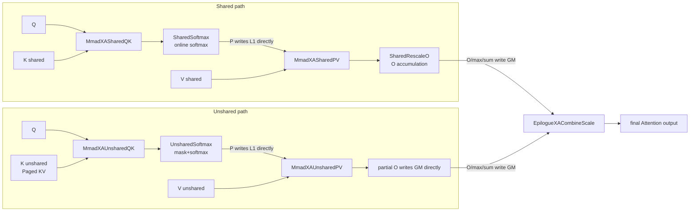
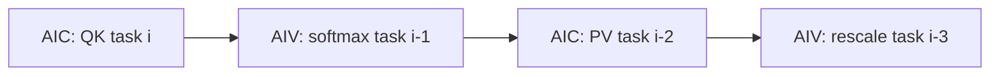

# XA TLA Series x_attention Inference Kernel Design Document

## Series Overview

The XA TLA series is a TLA instruction implementation for the **Ascend 950 (Arch::Ascend950) x_attention inference scenario**. Unlike the FD/XFAI series (Atlas A2 hardware path), this series:

- Directly specializes `BlockMmadTla`, using the Cube-side TLA hardware instruction (`MmadTla`) to perform matrix multiplication;
- Targets a **shared / unshared dual-path KV architecture**: the shared path handles the system prefix KV shared between batches (streaming online softmax), the unshared path handles the per-batch independent decode KV (Paged KV Cache + step-by-step mask), and finally the Combine path merges the partial outputs of the two paths;
- AIC (Cube) and AIV (Vector) cooperate deeply through cross-core flags to form a multi-level software pipeline.

The XA TLA series adds 8 templates in total (4 GEMM + 4 Epilogue):

| Template | Type | File |
| --- | --- | --- |
| `MmadXASharedQK` | BlockMmadTla | `include/catlass/gemm/block/block_mmad_tla_xa_shared_qk_ascend950.hpp` |
| `MmadXAUnsharedQK` | BlockMmadTla | `include/catlass/gemm/block/block_mmad_tla_xa_unshared_qk_ascend950.hpp` |
| `MmadXASharedPV` | BlockMmadTla | `include/catlass/gemm/block/block_mmad_tla_xa_shared_pv_ascend950.hpp` |
| `MmadXAUnsharedPV` | BlockMmadTla | `include/catlass/gemm/block/block_mmad_tla_xa_unshared_pv_ascend950.hpp` |
| `EpilogueXASharedSoftmax` | BlockEpilogue | `include/catlass/epilogue/block/block_epilogue_xa_shared_softmax_ascend950.hpp` |
| `EpilogueXAUnsharedSoftmax` | BlockEpilogue | `include/catlass/epilogue/block/block_epilogue_xa_unshared_softmax_ascend950.hpp` |
| `EpilogueXASharedRescaleO` | BlockEpilogue | `include/catlass/epilogue/block/block_epilogue_xa_shared_rescale_ascend950.hpp` |
| `EpilogueXACombineScale` | BlockEpilogue | `include/catlass/epilogue/block/block_epilogue_xa_combine_scale_ascend950.hpp` |

Overall three-path data flow:



> The Shared path accumulates the partial O directly in UB through streaming online softmax (controlled by isFirstKv/isLastKv) and writes it out only on the last KV block; each task of the Unshared path completes one full softmax independently (including the variable-length mask), and the partial O is written directly to GM. Each path writes its own copy of O/max/sum to GM, and CombineScale finally merges them according to the LSE mathematics.

## Registration Mechanism: xa_register.hpp

On the engineering side (xllm-ops `common/catlass/include/catlass_patch/xa_register.hpp`), the XA TLA series is registered through the "**empty-shell Policy + conditional include**" approach:

```cpp
// Gemm namespace: 4 empty-shell Policies (carrying only ArchTag and STAGES metadata)
namespace Catlass::Gemm {
template <typename ArchTag_>
struct MmadXASharedQK : MmadBase<ArchTag_, false> {
    static constexpr int32_t STAGES = 2;
};
// MmadXAUnsharedQK / MmadXASharedPV / MmadXAUnsharedPV are analogous
} // namespace Catlass::Gemm

// Epilogue namespace: 4 empty-shell structs
namespace Catlass::Epilogue {
template <typename ArchTag_>
struct EpilogueXASharedSoftmax { using ArchTag = ArchTag_; };
// EpilogueXAUnsharedSoftmax / EpilogueXASharedRescaleO / EpilogueXACombineScale are analogous
} // namespace Catlass::Epilogue

// pull in all 8 block specialization implementations under the 950 architecture
#if CATLASS_ARCH == 3510
#include "catlass/gemm/block/block_mmad_tla_xa_shared_qk_ascend950.hpp"
// ... the remaining 7 headers
#endif
```

Usage points:

1. **Must be included after the catlass aggregate headers**: the empty-shell Policy structs only occupy the namespace, and the real `BlockMmadTla<Policy<...>>` / `BlockEpilogue<Policy<...>>` partial specializations are supplied by the 8 headers above;
2. **Overridden through `-I` search order**: in the project CMake, the `common/catlass/include` path takes precedence over the third-party `catlass/include`, keeping the third-party submodule xa-free and concentrating all XA extensions in the project's own code;
3. This mechanism is the standard paradigm for landing "extensions not submitted to the CATLASS main repository" as engineering patches.

## GEMM Template Design

### Common Skeleton

All 4 GEMMs take the following partial specialization form:

```cpp
template <typename ArchTag_, typename L1TileShape_, typename L0TileShape_,
          typename ElementA_, typename ElementB_, typename ElementC_, typename ElementBias_,
          typename TileCopy_, typename TileMmad_>
class BlockMmadTla<MmadXASharedQK<ArchTag_>, L1TileShape_, L0TileShape_,
                   ElementA_, ElementB_, ElementC_, ElementBias_, TileCopy_, TileMmad_> {
    // STAGES = 2; double-buffered L1A / L1B / L0A / L0B / L0C
};
```

- **Three-level transfer**: GM → L1 (`CopyGm2L1`) → L0 (`CopyL12L0`) → TLA matrix multiply (`MmadTla`) → L0C → (the epilogue or the upper layer consumes the L0C/UB result);
- **Event ID pattern for double buffering** (`i = 0/1` is the slot):
  - `l1BEvent = BLOCK_EVENT_ID + i + STAGES`, `l0AEvent = i`, `l0BEvent = i + STAGES`, `l0CEvent = BLOCK_EVENT_ID + i`;
  - All events are `SetFlag`-preset in the constructor so that the first round of transfers does not need to wait;
- **Grouped event segments for QK/PV**: QK-class GEMM uses `BLOCK_EVENT_ID = 0`, PV-class uses `BLOCK_EVENT_ID = 4`, so the two GEMM groups in the same kernel do not interfere;
- **Cross-core synchronization**: `SYNC_MODE = 4`, synchronizing with the AIV side through `CrossCoreWaitFlag<SYNC_MODE, PIPE_FIX>` (plus the +16 offset AIV1 event), waiting for the flag by which the epilogue releases the UB/L1 resources.

### Difference Matrix

| Dimension | MmadXASharedQK | MmadXAUnsharedQK | MmadXASharedPV | MmadXAUnsharedPV |
| --- | --- | --- | --- | --- |
| BLOCK_EVENT_ID | 0 | 0 | 4 | 4 |
| A matrix supply | Q is GM→L1 only on isFirstKv, reused across kv blocks | loaded from GM on every call | P resides in L1 (constructor does not allocate l1A) | P is taken from the passed-in L1 tensor |
| B matrix supply | GM→L1 | GM→L1 | GM→L1 | GM→L1 |
| TileShape constraints | the three axes may differ | M/K axes identical; L1_N is an integer multiple of L0_N | the three axes of L1/L0 must be identical | M/N axes identical; L1_K is an integer multiple of L0_K |
| Inner loop split | single mmad (L1 granularity) | nLoops: split the N axis by L0_TILE_N | single mmad | kLoops: split the K axis by L0_TILE_K (init when kIdx==0) |
| L0C space | regular | L0C size computed by L1_TILE_N | regular | **reuses the first 128×128 area of the QK 128×256 L0C** |
| Cross-core flag | QK_UB_RELEASE_FLAG (uint64_t) | QK_UB_RELEASE_FLAG (uint16_t) | PV_UB_RELEASE_FLAG (uint16_t) | none |
| Additional operator() parameters | isFirstKv / isLastKv / releaseFlag | releaseFlag / taskIdL0C | releaseFlag | none (three taskIds) |

### MmadXASharedQK: Q Reuse Across KV Blocks

- Q (the beam dimension, M axis) is unchanged for all KV blocks of the same (batch, qHead), so `CopyGm2L1` loads Q into L1A only on `isFirstKv`; subsequent KV blocks reuse it directly, saving repeated transfers;
- On `isLastKv` the l1A double-buffer slot is toggled (`l1AEvent = 1 - l1AEvent`), ensuring that the Q loading of the next task does not conflict with the consumption of the current task;
- K (the KV block on the N axis) is loaded from GM into L1B every time;
- The result S is written into the `qkTensorList[taskIdMod2]` double buffer in UB, granting the AIV side permission to consume it through `QK_UB_RELEASE_FLAG` (uint64_t).

### MmadXAUnsharedQK: Inner Loop on the N Axis

- Both Q/K are loaded from GM on every call (Q differs between tasks);
- L1 loads `L1_TILE_N` columns at a time and L0 only `L0_TILE_N` columns, with `nLoops = L1_TILE_N / L0_TILE_N` inner iterations:
  - each round `CopyL12L0` moves the L0 column block of B → `MmadTla` accumulates into the same L0C slot;
  - after `nLoops` completes, L0C → UB;
- Suited to the large-N block (for example 128×256) scenario of the unshared path where `blockKvLen = groupCountPerLoop × maxDecodeStep`;
- `operator()` takes the three-taskId form `(tensorA, tensorB, tensorC, actualShape, releaseFlag, taskIdL0A, taskIdL0B, taskIdL0C)`.

### MmadXASharedPV: P Resides in L1

- The A matrix P (the softmax output) is written directly into L1 by the epilogue (`CopyUb2L1Tla`), so the constructor **does not allocate an l1A buffer**, only l1B/l0A/l0B/l0C;
- The TileShape must be identical across the three axes of L1/L0 (P is laid out in L1 as a whole block at L1 granularity);
- V (the B matrix) goes GM→L1→L0 every time;
- The computed result O_tmp is written into the `pvTensorList[taskIdMod2]` UB double buffer, and `PV_UB_RELEASE_FLAG` is set and released after the SharedRescaleO epilogue consumes it.

### MmadXAUnsharedPV: Inner Loop on the K Axis + L0C Reuse

- P (A) is obtained from the passed-in L1 tensor (written directly by the epilogue), and V (B) goes GM→L1→L0;
- `kLoops = L1_TILE_K / L0_TILE_K` inner iterations split the K axis, with `init=false` when `kIdx == 0` (first matrix) and `init=true` for accumulation afterwards;
- **L0C reuse**: `SHARED_L0C_STAGE_SIZE = L1_TILE_M × L1_TILE_K × sizeof(acc)`, directly reusing the first 128×128 sub-area of the 128×256 L0C area already requested by the QK GEMM; the L0C pointer of PV points to this area after construction, saving total L0C (L0C is limited, and time-sharing it between QK and PV is a common technique on the 950);
- No cross-core release flag: the O_tmp result is written directly to GM by AIC through the FIX channel (the unshared-path partial O writes directly).

## Epilogue Template Design

### EpilogueXASharedSoftmax: Streaming Online Softmax

```cpp
template <typename Policy_, typename L1TileShape_, typename PType_, typename SType_>
class BlockEpilogue<EpilogueXASharedSoftmax<...>, ...> {
    BlockEpilogue(Resource *resource, uint32_t &ubBufAddrStart,
                  float scaleValue, int32_t qHeads);
    // operator() has 18 parameters in total
};
```

- **UB resources**: `pNzOutTensorList[2]` (pingpong for P in NZ format) + `maxBrcb/sumBrcb` broadcast intermediates;
- **Key operator() parameters**: five softmax scalars (`lastExpSum/nowExpSum/nowExpMax/lastMax/nowMax`, triple buffered and rotating with taskIdMod3), three flag groups (`SYNC_QK_READY / SYNC_SOFTMAX_READY / QK_UB_RELEASE`), and `isUpdate / isLastKv`;
- **Execution flow**:
  1. `CrossCoreWaitFlag(SYNC_QK_READY)` waits for AIC to finish QK;
  2. `ComputeScaleandMax`: row ReduceMax after S×scale, with `UpdateMax` fusing the historical max (`nowMax = max(lastMax, rowMax)`);
  3. `ComputeExpSubSum`: S becomes P through `exp(nowMax - S)`, written to UB in **NZ format** (odd/even separated layout for Half not aligned to 16) through `DATA_BLOCK_COPY`, then the row partial sum of exp is computed;
  4. `CrossCoreSetFlag(QK_UB_RELEASE)` releases the QK UB double buffer;
  5. `CopyUb2L1Tla`: P is written directly from UB into the PV A matrix area of L1;
  6. `CrossCoreSetFlag(SYNC_SOFTMAX_READY)` notifies AIC to start PV;
  7. `UpdateExpSumAndExpMax`: `nowExpSum = lastExpSum×exp(lastMax-nowMax) + curSum`;
  8. On `isLastKv`, `CopyOutMaxAndSum`: Brcb + `DataCopyPad` write the per-row max/sum to GM by `qHeads` stride (for CombineScale to consume).

### EpilogueXAUnsharedSoftmax: Mask + Independent Softmax

```cpp
BlockEpilogue(Resource *resource, uint32_t &ubBufAddrStart, float scaleValue,
              int32_t unsharedKvLen, int32_t maxDecodeStep,
              int32_t groupCountPerLoop, int32_t groupSize);
```

- **Mask mechanism (core difference)**: the KV of the unshared path consists of variable-length decode steps; at construction, `InitUnsharedMask` pre-generates a uint8 mask (0/1) with `Duplicate` according to `groupCountPerLoop / groupSize / maxDecodeStep`, and loads it into `maskUbTensor` (HALF_MASK_BLOCK_SIZE); it is 1 within the effective KV length and 0 beyond. It supports dual-SubBlock division of labor (`UINT8_BLOCK_SIZE=256` alignment + floorSub handling the odd row split);
- **ComputeMaskandScale**: row ReduceMax after `Select(mask, S×scale, MIN_VALUE=-3e38)`, implementing variable-length KV masking; the N axis is handled in three branches `N128 / N0_64 / N65_127`; the mask itself is loaded through `pregCompare` of `LoadAlign<MASK>`;
- **Independent per step**: there is no `isUpdate/isLastKv` streaming logic; each task performs one complete softmax (exp/max/sum are all independent values of this step), and `CopyOutMaxAndSum` **executes on every call** (`DataCopyPad` writes GM, V_MTE3 EVENT_ID7 synchronization);
- `QK_UB_RELEASE_FLAG` is uint16_t (distinguishing it from the uint64_t of the Shared path).

### EpilogueXASharedRescaleO: O Accumulation + PV Release Loop Closure

```cpp
BlockEpilogue(Resource *resource, uint32_t &ubBufAddrStart);  // only 2 parameters
// operator()(attenOutGm, expMaxUb, pvRes, isFirstKv, isLastKv, PV_RELEASE_FLAG)
```

- **UB resources**: only `attnTmpBuf` (`VEC2_UB_SIZE = HALF_S1 × D × sizeof`, the accumulation buffer of O);
- **Execution flow**:
  1. `isFirstKv`: `DataCopy(attnTmp ← pvRes)` initialization;
  2. otherwise `FlashUpdateNew`: `O_new = expMax × O_old + PV_cur`, with expMax loaded through per-row Brcb broadcast and nLoops splitting the D axis by vlSize;
  3. `isLastKv`: `CopyUbToGmO` writes the final partial O;
  4. **`CrossCoreSetFlag(PV_RELEASE_FLAG)`**: after consuming `pvRes`, release the UB double buffer of the PV GEMM — this is the consumer of `PV_UB_RELEASE_FLAG` in `MmadXASharedPV`, forming a complete producer-consumer loop closure.

### EpilogueXACombineScale: Dual-Path LSE Merge

```cpp
BlockEpilogue(Resource *resource, uint32_t &ubBufAddrStart,
              int32_t rowNumPerLoop, int32_t headDim);
// operator()(sharedMax/Sum/Gm, unsharedMax/Sum/Gm, gFinalOutput, m, taskId&)  8 parameters in total
```

- The template has only 2 parameters (`OutputType/InputType`) and no TileShape dependency; it is a pure Vector merge operator;
- **UB resources**: 7 groups of pingpong buffers (attn/gm/gl of shared/unshared + finalAttn, each `[2]`) + 3 tmp buffers (finalGl/expMaxShared/expMaxUnShared);
- **Merge mathematics (standard LSE merge)**:

```
finalMax  = max(sharedMax, unsharedMax)
finalGl   = sharedSum × exp(sharedMax − finalMax) + unsharedSum × exp(unsharedMax − finalMax)
O_final   = (O_shared × exp(sharedMax − finalMax) + O_unshared × exp(unsharedMax − finalMax)) / finalGl
```

- **Execution flow**: DataCopy loads the two paths of O/max/sum → `ComputeExpSumAndExpMax` → `ComputeFinalAttn` (nLoops splits headDim by vlSize) → Cast to ElementOutput → DataCopy writes `gFinalOutput` → `taskId = 1 - taskId` toggles the pingpong.

## Cross-Core Synchronization Flag Summary

| Flag | Producer | Consumer | Semantics |
| --- | --- | --- | --- |
| `SYNC_QK_READY_FLAG[i]` (+16 AIV1 mirror) | AIC: QK GEMM completes | AIV: softmax starts reading the QK result | QK S is ready |
| `QK_UB_RELEASE_FLAG[i]` | AIV: softmax finished consuming S / preset at the kernel tail | AIC: QK GEMM reuses the qkTensorList slot | QK UB slot is free |
| `SYNC_SOFTMAX_READY_FLAG[i]` (+16) | AIV: P has been written to L1 | AIC: PV GEMM starts reading L1A | P is ready |
| `SYNC_PV_READY_FLAG[i]` (+16) | AIC: PV GEMM completes | AIV: Rescale starts reading pvRes | PV O is ready |
| `PV_UB_RELEASE_FLAG[i]` | AIV: Rescale finished consuming pvRes / preset at the kernel tail | AIC: PV GEMM reuses the pvTensorList slot | PV UB slot is free |

## Kernel Assembly and Software Pipeline

The three assembled kernels are located in the `x_attention/op_kernel/arch35/` directory of xllm-ops. AIC and AIV are bound in a "dual-core launch" manner (`CV_RATIO = 2` means 1 Cube core carries 2 Vector cores), and the shared and unshared kernels are launched staggered on the same batch of cores through `sharedInfo.usedCoreNum`.

### SharedFaInferKernel: 4-Level Software Pipeline (shared_infer_catlass_kernel.h, 444 lines)

```cpp
SharedFaInferKernel<BlockMmadQK, BlockMmadPV, EpilogueOnlineSoftmax, EpilogueRescaleO, KVLEN_T>;
// BlockMmadQK = BlockMmadTla<MmadXASharedQK<...>, Shape<_128,_128,_128>, Shape<_128,_128,_128>, ...>
// BlockMmadPV = BlockMmadTla<MmadXASharedPV<...>, ...>
// EpilogueOnlineSoftmax = BlockEpilogue<EpilogueXASharedSoftmax<...>, ...>
// EpilogueRescaleO      = BlockEpilogue<EpilogueXASharedRescaleO<...>, ...>
```

It uses a **4-level software pipeline** with the `taskArgList[4]` ring queue, and the main loop condition is `qTaskId < taskEndId + 3` (running 3 extra rounds to drain the pipeline):

| Pipeline level | Executor | Task | Key synchronization |
| --- | --- | --- | --- |
| level 0 | AIC | QK GEMM of the current qTaskId | wait for `QK_UB_RELEASE_FLAG` |
| level 1 | AIV | softmax lagging by 1 beat (taskId-1) | wait for `SYNC_QK_READY_FLAG` |
| level 2 | AIC | PV GEMM lagging by 2 beats (taskId-2) | first wait for `SYNC_SOFTMAX_READY` before Mmad, then set `SYNC_PV_READY` after completion |
| level 3 | AIV | Rescale lagging by 3 beats (taskId-3) | wait for `SYNC_PV_READY_FLAG` |



- **UB multi-buffering**: `qkTensorList[2]` + `pvTensorList[2]` pingpong; the softmax scalars `expSumUb[3] / expMaxUb[3] / maxUb[3]` are triple buffered (matching the number of lagging beats);
- **L1 multi-buffering**: `pL1TensorList[3]` (triple buffering of P in L1);
- **AIV dual-core division of labor**: `coreIdx = coreIdx / CV_RATIO` gives the logical core index, and `subVecIdx = coreIdx % CV_RATIO` decides whether the front or back half of `halfBlockQLen` is processed;
- **Task splitting**: `GetQTaskInfo` splits Q tasks by batch / qHead / qBlock; `GetKvTaskInfo` computes `isFirstKv / isUpdate / isLastKv / taskIdMod2 / taskIdMod3`;
- **Warm-up SetFlag**: at the kernel entry AIC sets M_MTE1 EVENT_ID 0-3, and AIV sets 4 UB_RELEASE flags, eliminating the first-round wait;
- All `SYNC_*_READY` flags are set twice (including the +16 offset AIV1 mirror event).

### UnSharedInferKernel: 3-Level Software Pipeline + Page Table Addressing (unshared_infer_catlass_kernel.h, 375 lines)

```cpp
UnSharedInferKernel<BlockMmadQK, BlockMmadPV, EpilogueSoftmax, KVLEN_T, TABLE_T>;
// BlockMmadQK = BlockMmadTla<MmadXAUnsharedQK<...>, ...>
// BlockMmadPV = BlockMmadTla<MmadXAUnsharedPV<...>, ...>
// EpilogueSoftmax = BlockEpilogue<EpilogueXAUnsharedSoftmax<...>, ...>
```

A **3-level software pipeline** with the `taskArgList[3]` ring queue, and the main loop condition is `groupTaskId < taskEndId + 2`:

| Pipeline level | Executor | Task | Description |
| --- | --- | --- | --- |
| level 0 | AIC | QK GEMM of the current groupTaskId | — |
| level 1 | AIV | mask softmax lagging by 1 beat | writes max/sum to GM at every step |
| level 2 | AIC | PV GEMM lagging by 2 beats | **O is written directly to GM (tensorOTile)**, no rescale level and no PV flag |

- **Paged KV Cache addressing**: `blockTableGm.GetValue(batchId)` gives `cacheBlockId`, then `gK[cacheBlockId * kvBatchStride]` locates the physical page base address — the GM tensors of K/V are computed dynamically inside the task loop;
- **Task splitting**: `groupTaskId` splits the batch and `groupCountBlockId` splits the groups; `blockQLen = groupCountPerLoop × groupSize`, `blockKvLen = groupCountPerLoop × maxDecodeStep`;
- **AIV dual-SubBlock division of labor**: `halfVecGroupCount` splits the group count, and `halfVecRowCount / halfVecRowOffset` split the rows;
- **Core offset**: `coreIdx` minus `sharedInfo.usedCoreNum` — launched staggered within the same physical core domain as the shared kernel;
- UB has only `qkTensorList[2]`, and L1 has `pL1TensorList[3]`.

### CombineScaleKernel: Pure AIV Merge (combine_kernel.h, 151 lines)

```cpp
CombineScaleKernel<EpilogueCombineScale>;
// EpilogueCombineScale = BlockEpilogue<EpilogueXACombineScale<...>, InputType, OutputType>
```

- **Pure AIV kernel**: the AIC is specialized to an empty `return`, and all work is done on the Vector core;
- **former/tail two-level task splitting**: `formerCoreNum / formerTaskNum / tailCoreNum` provide inter-core load balancing; each core loops `coreTaskNum` times, calling the epilogue with `rowNumPerLoop` rows each time (`realRowNum` is clamped by the remaining rows);
- 7 GM tensors (max/sum/O of shared/unshared + gFinalOut) get their per-core offsets from `gmglOffsetPerCore / attnOffsetPerCore`.

## Usage Example

The following is excerpted from xllm-ops (https://gitcode.com/xLLM-AI/xllm_ops) `x_attention/op_kernel/x_attention_catlass_helper.h` (124 lines), showing the assembly entries of the three kernels.

### Shared Path Entry: CallSharedInferKernel

```cpp
template <typename INPUT_T, typename TILING_T>
__aicore__ inline void CallSharedInferKernel(const TILING_T &tiling, SharedInfo &sharedInfo,
                                             const INPUT_T *query, const INPUT_T *key,
                                             const INPUT_T *value, float *attnOut,
                                             float *attnMax, float *attnSum, ...) {
    using ShapeType = Shape<_128, _128, _128>;             // L1TileShape
    using L0ShapeType = Shape<_128, _128, _128>;           // L0TileShape
    using LayoutK = ACL_CALL_FUNC_NAMESPACE::Layout::ColumnMajor;
    using ElementS = float;
    using ElementOTmp = float;

    using BlockMmadQK = Catlass::Gemm::BlockMmadTla<Catlass::Gemm::MmadXASharedQK<Arch::Ascend950>,
            ShapeType, L0ShapeType, INPUT_T, INPUT_T, ElementS, Catlass::Gemm::Tag, ...>;
    using BlockMmadPV = Catlass::Gemm::BlockMmadTla<Catlass::Gemm::MmadXASharedPV<Arch::Ascend950>,
            ShapeType, L0ShapeType, ElementS, INPUT_T, ElementOTmp, Catlass::Gemm::Tag, ...>;
    using EpilogueOnlineSoftmax = Catlass::Epilogue::BlockEpilogue<
            Catlass::Epilogue::EpilogueXASharedSoftmax<Arch::Ascend950>, ...>;
    using EpilogueRescaleO = Catlass::Epilogue::BlockEpilogue<
            Catlass::Epilogue::EpilogueXASharedRescaleO<Arch::Ascend950>, ...>;

    using Kernel = SharedFaInferKernel<BlockMmadQK, BlockMmadPV,
                                        EpilogueOnlineSoftmax, EpilogueRescaleO, KVLEN_T>;
    Kernel::Invoke(tiling, sharedInfo, query, key, value, attnOut, attnMax, attnSum, ...);
}
```

### Unshared Path Entry: CallUnsharedInferKernel

```cpp
using BlockMmadQK = Catlass::Gemm::BlockMmadTla<Catlass::Gemm::MmadXAUnsharedQK<Arch::Ascend950>,
        ShapeType, L0ShapeType, INPUT_T, INPUT_T, ElementS, Catlass::Gemm::Tag, ...>;
using BlockMmadPV = Catlass::Gemm::BlockMmadTla<Catlass::Gemm::MmadXAUnsharedPV<Arch::Ascend950>,
        ShapeType, L0ShapeType, ElementS, INPUT_T, ElementOTmp, Catlass::Gemm::Tag, ...>;
using EpilogueSoftmax = Catlass::Epilogue::BlockEpilogue<
        Catlass::Epilogue::EpilogueXAUnsharedSoftmax<Arch::Ascend950>, ...>;

using Kernel = UnSharedInferKernel<BlockMmadQK, BlockMmadPV, EpilogueSoftmax, KVLEN_T, TABLE_T>;
Kernel::Invoke(...);  // blockTableGm page table + unshared K/V
```

### Combine Entry: CallCombineScale

```cpp
using EpilogueCombineScale = Catlass::Epilogue::BlockEpilogue<
        Catlass::Epilogue::EpilogueXACombineScale<Arch::Ascend950>, OutputType, InputType>;
using Kernel = CombineScaleKernel<EpilogueCombineScale>;
Kernel::Invoke(sharedMax, sharedSum, sharedAttn, unsharedMax, unsharedSum,
               unsharedAttn, finalOut, totalRowNum, rowNumPerLoop, headDim);
```

The three entries are called in order at the operator layer (the `OpKernel` implementation of `x_attention`): first shared and unshared (staggered in the same core domain), and finally combine to merge the output. The caller only needs to ensure that the fields given in the tiling, such as `sharedKvLen / unsharedKvLen / groupSize / maxDecodeStep / qHeads`, are consistent with the GM tensor layout.

## Constraints and Notes

1. **Architecture constraint**: only Ascend 950 is supported (`CATLASS_ARCH == 3510`), and the registration header must be placed after the catlass aggregate headers;
2. **TileShape constraints**:
   - SharedQK: no coupling constraint between L1/L0 (typically both are 128×128×128);
   - UnsharedQK: the L1 and L0 of the M/K axes are identical, and `L1_TILE_N` must be an integer multiple of `L0_TILE_N`;
   - SharedPV: the three axes of L1/L0 must be identical;
   - UnsharedPV: the M/N axes are identical, and `L1_TILE_K` must be an integer multiple of `L0_TILE_K`;
3. **L0C reuse dependency**: UnsharedPV reuses the L0C area of QK, so the two GEMMs must be constructed within the same kernel in QK→PV order, and `L1_TILE_M × L1_TILE_K` must fall within the QK L0C budget;
4. **Element types**: the typical combination is Q/K/V/P = `INPUT_T` (half/bf16), S/OTmp = `float`, and the K layout is `ColumnMajor`;
5. **Flag types**: `QK_UB_RELEASE_FLAG` is uint64_t on the Shared path and uint16_t on the Unshared path; they must not be mixed when planning cross-core event IDs;
6. **Pipeline depth is buffer depth**: the triple buffering of the softmax scalars and the triple buffering of P in L1 on the Shared path correspond strictly to the 4-level pipeline (lagging by at most 3 beats); when modifying the pipeline structure, the buffer counts must be adjusted accordingly.
