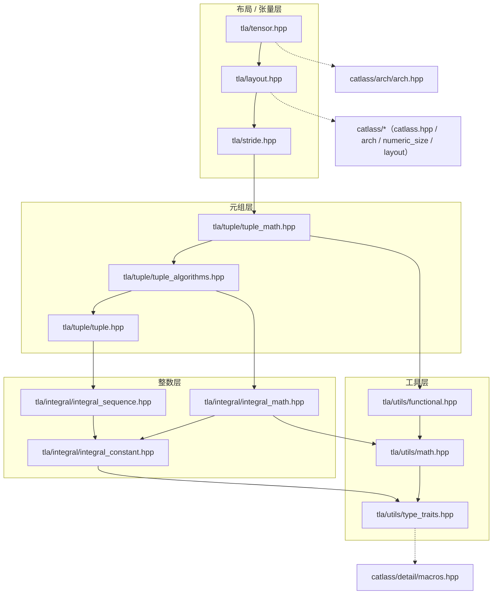

# TLA 模块架构

本文描述 `include/tla/` 的模块边界、直接头文件依赖和公共语义。内容以源码为准；它补充 [Layout](./01_layout.md)、[LayoutTag](./02_layout_tag.md) 和 [Tensor](./03_tensor.md) 的接口说明，不替代它们。

## 目录与分层

```text
include/tla/
├── utils/
│   ├── type_traits.hpp       # 类型萃取、转发与 tuple 元信息
│   ├── math.hpp              # 标量运算
│   └── functional.hpp        # 函数对象与折叠器
├── integral/
│   ├── integral_constant.hpp # 编译期常量及其类型判定
│   ├── integral_sequence.hpp # 编译期整数序列
│   └── integral_math.hpp     # 编译期整数运算
├── tuple/
│   ├── tuple.hpp             # tla::tuple 与 get
│   ├── tuple_algorithms.hpp  # tuple 变换、选择、折叠等算法
│   └── tuple_math.hpp        # 整数 tuple 的算术和聚合
├── tuple.hpp                 # tuple 基础类型的兼容入口
├── stride.hpp                # 紧凑 stride 与坐标/索引换算
├── layout.hpp                # Layout、布局工厂和布局变换
└── tensor.hpp                # Tensor 视图、切片和 tile 视图
```

依赖由下至上组织为：`utils` → `integral` → `tuple` → `stride` → `layout` → `tensor`。这是概念分层，而非“上层只能直接包含下一层”：`layout.hpp` 和 `tensor.hpp` 为了提供单头文件入口，会直接包含多个下层头文件。

## 依赖关系

下图保留模块依赖的传递约简：`A --> B` 表示 A 建立在 B 之上；已可由中间模块推导出的边不再重复绘制。实际的直接 `#include` 列表见下一节。



## 直接 `#include` 依赖

下表只列 TLA 内部的直接依赖；所有 TLA 头文件还会按需包含 C++ 标准库或 `catlass/detail/macros.hpp`。

| 头文件 | 直接依赖的 TLA 头文件 | 主要职责 |
| --- | --- | --- |
| `utils/type_traits.hpp` | 无 | `remove_cvref`、`tuple_size`/`tuple_element` 包装、`forward`/`move`、SFINAE 宏等基础设施。 |
| `utils/math.hpp` | `utils/type_traits.hpp` | 标量 `max`、`min`、`clip_sub`、`ceil_div`、`round_up`、`abs`。 |
| `utils/functional.hpp` | `utils/type_traits.hpp`、`utils/math.hpp` | `identity`、比较/算术函数对象和 `multiplies_unary_lfold`。 |
| `integral/integral_constant.hpp` | `utils/type_traits.hpp` | `integral_constant<T, v>`、`C<v>`、`Int<v>`、`_` 及相关判定。 |
| `integral/integral_sequence.hpp` | `integral/integral_constant.hpp`、`utils/type_traits.hpp` | `IntegerSequence`、`make_*_sequence`、`make_range`、`make_rseq`。 |
| `integral/integral_math.hpp` | `integral/integral_constant.hpp`、`utils/math.hpp`、`utils/type_traits.hpp` | `C<>` 的运算符、静态/动态混合特例和 `conditional_return`。 |
| `tuple/tuple.hpp` | `integral/integral_constant.hpp`、`integral/integral_sequence.hpp`、`utils/type_traits.hpp` | `tla::tuple`、`get`、`make_tuple`、tuple 类型判定。 |
| `tuple/tuple_algorithms.hpp` | `tuple/tuple.hpp`、全部 integral 头文件 | `apply`、`select`、`take`、`transform`、`fold`、`flatten_to_tuple` 等。 |
| `tuple/tuple_math.hpp` | `tuple/tuple.hpp`、`tuple/tuple_algorithms.hpp`、`utils/{math,functional,type_traits}.hpp`、`integral/{integral_constant,integral_sequence}.hpp` | `is_int_tuple`、逐元素算术、`product`、`ceil_div`、`inner_product` 等。 |
| `stride.hpp` | 全部 tuple 头文件、`utils/type_traits.hpp`、`integral/{integral_constant,integral_sequence}.hpp` | `compact_*`、`crd2idx`/`crd2offset`、`idx2crd`。 |
| `layout.hpp` | `stride.hpp`、全部 tuple 头文件、`integral/{integral_constant,integral_math}.hpp`、`utils/{math,functional}.hpp` | `Layout`、布局构造、分形布局和 tile-layout 工具。 |
| `tensor.hpp` | `layout.hpp`、`integral/{integral_constant,integral_sequence,integral_math}.hpp`、`tuple/{tuple_algorithms,tuple_math}.hpp` | `Tensor`、下划线切片、`GetTile`、`TileView`、`MakeTensorLike`。 |

`layout.hpp` 还直接依赖 `catlass/catlass.hpp`、`catlass/arch/arch.hpp`、`catlass/numeric_size.hpp` 和 `catlass/layout/layout.hpp`；`tensor.hpp` 还直接依赖 `catlass/arch/arch.hpp`。因此，只有 `utils`、`integral`、`tuple` 与 `stride` 可以视作不依赖 CATLASS 布局/架构接口的基础层。

## 模块语义与使用入口

### 编译期整数与 tuple

- `integral_constant<T, v>` 是基础常量类型，`C<v>` 根据 `v` 推导其值类型；`Bool`、`Int` 和 `Int64` 是常用别名。
- `constant<T, v>` 和 `bool_constant<b>` 分别是 `integral_constant<T, v>` 和 `Bool<b>` 的别名。
- `_` 是 `Underscore` 的全局对象，用于 Tensor 下划线切片，不是普通数值常量。
- `_0`、`_1`、`_2` 等别名为源码列出的常用值生成，并同时提供相应的 `long long` 版本。
- `is_static<T>` 实现为 `is_empty<remove_cvref_t<T>>`，用于识别无状态的静态类型。
- `tuple/tuple.hpp` 提供 `tla::tuple` 和 `get`；需要结构变换时包含 `tuple/tuple_algorithms.hpp`；需要整数 tuple 的算术、聚合或 tiling 计算时包含 `tuple/tuple_math.hpp`。

`IntTuple` 在当前版本是“整数或递归整数 tuple”的概念，而不是一个独立声明的类型。相应判定由 `tuple/tuple_math.hpp` 中的 `is_int_tuple` 提供。

整数运算层会保留可静态确定的结果，包括部分常量与运行时整数的混合运算。结果类型可能是编译期常量；需要可修改的累加变量时，应显式转换为普通整数。示例见 [TLA API：常量求值与可修改的结果](../../3_API/include/tla/README.md#常量求值与可修改的结果)。

### Layout 与 Tensor

`Layout<Shape, Stride, OriginShape>` 私有继承保存这三个分量的 `tla::tuple`，并提供 `shape()`、`stride()`、`originShape()` 和坐标到元素偏移的 `operator()`：

```cpp
auto layout = tla::MakeLayout(tla::MakeShape(2, 4), tla::MakeStride(4, 1));
auto offset = layout(tla::MakeCoord(1, 2));  // 6
```

布局级 `get`、`take` 与 `select` 会同时投影 `shape`、`stride` 和 `originShape`，返回新的 `Layout`。`GetTileLayout` 会保留用于内存布局的 tile `shape`，并按元素坐标裁剪 `originShape`；深度为 1 的布局支持任意 rank，分形布局当前限制为 rank 2。

`Tensor` 将底层 AscendC Tensor、TLA `Layout`、当前视图坐标和存储位置组合为视图对象。`GetTile` 的 `coord` 是元素坐标，`TileView` 的 `tileCoord` 是 tile 坐标；两者均返回视图而不执行数据搬运。带 `_` 的 `Tensor::operator()` 保留被 `_` 标记的维度并返回子视图；固定维度索引越界时没有运行时检查。

## 建议的 include 选择

- 仅使用 tuple 基础类型：`tla/tuple.hpp`，它转发到 `tla/tuple/tuple.hpp`；使用结构变换算法时再包含 `tla/tuple/tuple_algorithms.hpp`。
- 仅使用编译期常量：`tla/integral/integral_constant.hpp`。
- 使用整数序列或静态整数算术：再包含 `integral_sequence.hpp` 或 `integral_math.hpp`。
- 使用 tuple 算术、`product`、`ceil_div`、`transform`：`tla/tuple/tuple_math.hpp`；它会包含 tuple 基础和算法头。
- 使用坐标/stride 换算：`tla/stride.hpp`。
- 使用布局工厂、分形布局或布局级选择操作：`tla/layout.hpp`。
- 使用 Tensor、切片或 tile 视图：`tla/tensor.hpp`。

公共入口与底层头文件的选择，以及仍引用旧路径时的替换方式，见 [TLA API：头文件选择](../../3_API/include/tla/README.md#头文件选择)。
