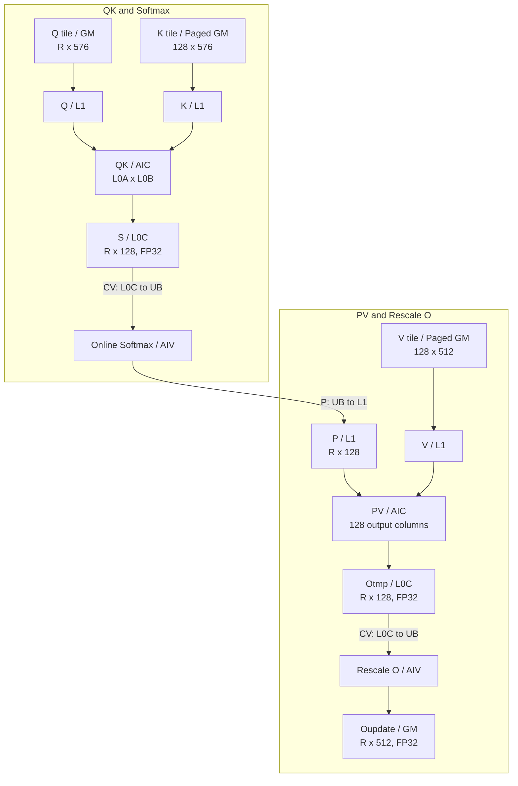
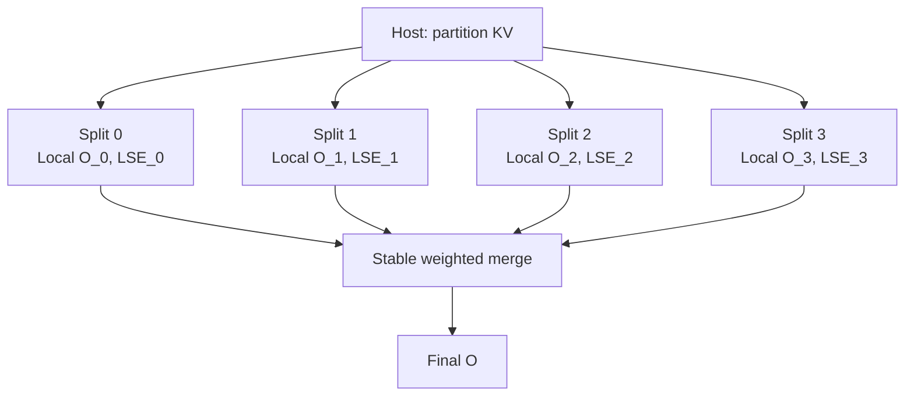
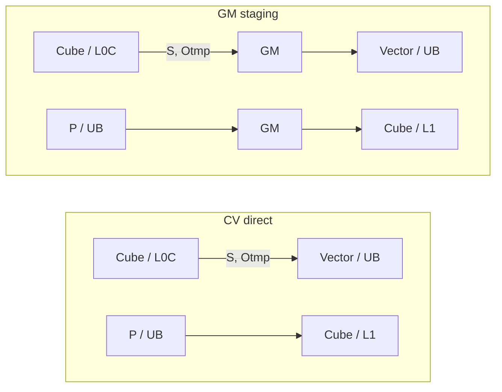
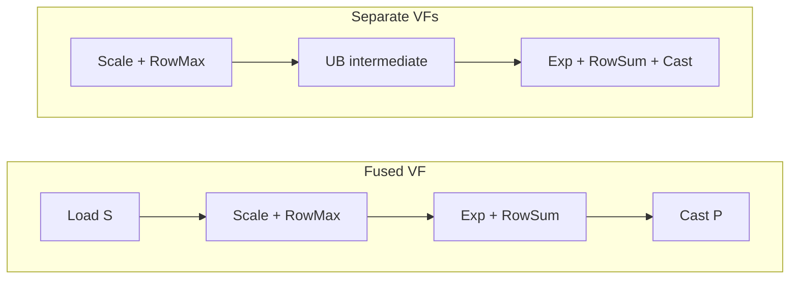
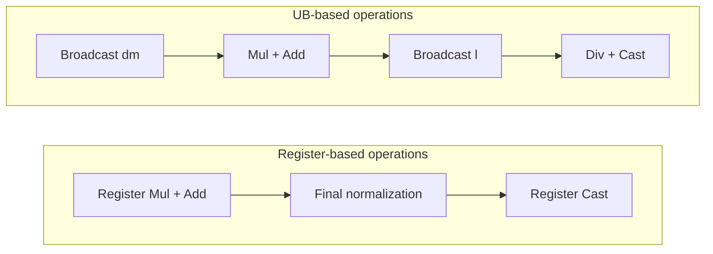
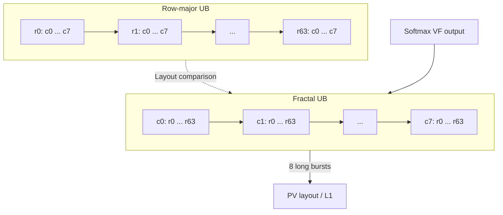
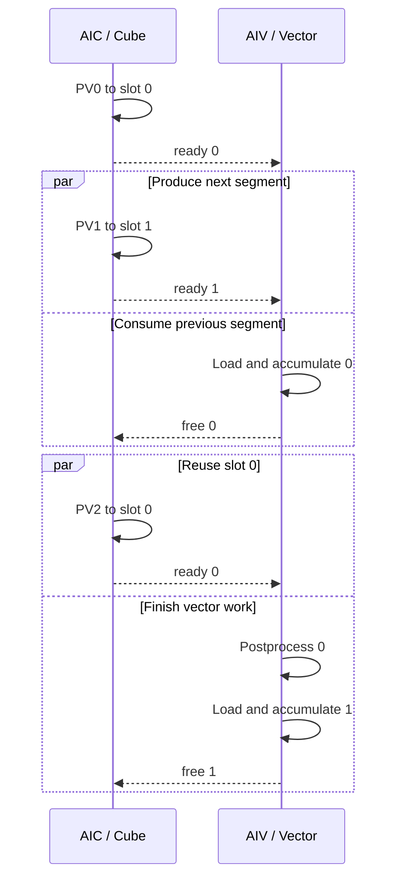

# Ascend 950 MLA 算子设计方案

## 一、算子实现方案

### 1. 输入与计算语义

MLA 使用共享的 latent cache，分别计算 Query 与 latent、RoPE 两部分的点积，再沿 KV 序列执行 Softmax。latent cache 同时作为 `K` 的 latent 分量和 `V` 使用，输出为 512 维 latent 结果。

$$
S = \frac{Q_{\mathrm{latent}} C_{\mathrm{latent}}^{\mathsf{T}} + Q_{\mathrm{rope}} C_{\mathrm{rope}}^{\mathsf{T}}}{\sqrt{512 + 64}}
$$

$$
O = \operatorname{Softmax}_{\mathrm{KV}}(S)\,C_{\mathrm{latent}}
$$

其中，缩放系数 `scale` 为 1/24。主路径的 Query 头数 `H` 为 128，KV 头数 `kvHeads` 为 1，latent 维度 `embeddingSize` 为 512，RoPE 维度 `embeddingSizeRope` 为 64，页大小 `blockSize` 为 128。Query 头数 `H` 同时支持 16、32 和 64；每个 batch 的 Query 长度 `qSeqLen` 支持 1～4。

| 输入 / 输出 | 形状 |
|---|---|
| Query latent / RoPE | `[ΣqS,H,512]` / `[ΣqS,H,64]` |
| latent / RoPE cache | `[num_blocks,128,1,512]` / `[num_blocks,128,1,64]` |
| `block_table` | `[B,max_blocks_per_batch]` |
| `q_seqlen` / `kv_seqlen` | `[B]` |
| Output | `[ΣqS,H,512]` |

### 2. 整体流程

整体流程如下图。一次任务选取一组 Query heads 和对应的 Query tokens，将两者组合为矩阵的行维。行数 `R` 为本次任务的头数 `qHeadSplit` 与 Query 长度 `qSeqLen` 的乘积，且不超过 128。随后沿 KV 序列逐 tile 推进，每个完整 KV tile 包含 128 个 token。

图中的尺寸表示逻辑分块。`576` 维由 512 维 latent 与 64 维 RoPE 组成；两部分输入实际分开读取，并分段送入 L0。`Q` 经 L1 送入 L0A，`K` 经 L1 以转置视图送入 L0B，计算得到 FP32 的 `S`。Softmax 输出的 `P` 为 FP16 或 BF16，经 UB 到 L1 后送入 L0A；`V` 经 L1 送入 L0B，参与 PV 计算。

PV 沿 512 维输出拆成四个 128 列分段。每次只将一个形状为 `[R,128]` 的 FP32 `Otmp` 分段从 L0C 交给两个 AIV，分别处理一半行。`R` 为 128 时，单次交接共 64 KiB，每个 AIV 接收 32 KiB；逻辑完整输出为 256 KiB，无需整体进入 UB。Rescale O 更新对应分段，并将中间累加状态写入 `Oupdate`。

当 `R` 为 128 时，逻辑 `Q`、`K` tile 均为 144 KiB，`V` tile 为 128 KiB，FP32 的 `S` 为 64 KiB，FP16 或 BF16 的 `P` 为 32 KiB。这些数值用于说明分块数据量，不表示各逻辑 tile 都完整驻留在对应的 L0 缓冲中。

### 3. split-KV 合并

设已有行最大值、指数和及未归一化输出为 `m`、`l`、`A`，当前 KV tile 的缩放后 score 和对应的 `V` 分块为 `S_j`、`V_j`，在线更新关系如下：

$$
\begin{aligned}
m' &= \max\!\left(m,\operatorname{rowmax}(S_j)\right), \\
\alpha &= \exp(m-m'), \\
P_j &= \exp(S_j-m'), \\
l' &= \alpha l + \operatorname{rowsum}(P_j), \\
A' &= \alpha A + P_j V_j, \\
O &= \frac{A'}{l'}.
\end{aligned}
$$

其中，`rowmax` 和 `rowsum` 分别沿当前 KV tile 的列维求最大值与求和；各行的统计量与矩阵之间的逐元素运算按行广播，$P_j V_j$ 为矩阵乘法。遍历完全部 KV tile 后，用最终的 `A'` 和 `l'` 得到归一化输出 `O`。

长 KV 且任务数不足时，可沿 KV 序列拆分任务以提高多核利用率。各分片独立计算局部输出与 LSE，再通过加权得到最终 `O`。

图中以四个分片示意，分片数量由实际 KV 长度和任务划分决定。每个分片依次遍历所分配的 KV tiles，更新局部 `m`、`l` 和 `A`，得到局部输出 `O_i` 与 `LSE_i`。合并时先减去各分片 `LSE_i` 的最大值，再计算权重；以下运算对每个 Query 行独立执行：

$$
L = \max_i \mathrm{LSE}_i,\qquad
w_i = \exp(\mathrm{LSE}_i-L),\qquad
O = \frac{\sum_i w_i O_i}{\sum_i w_i}.
$$

## 二、优化方案

### 1. CV 直连通路利用

将 `S`、`P`、`Otmp` 在计算阶段间的传递从 GM 中转改为片上直连，减少外存往返和数据交接开销。

以 `R` 为 32、KV tile 包含 128 个 token、输出维度为 512 的情况为例，`S`、`P`、四个 `Otmp` 分段合计分别为 16、8、64 KiB。相对全部经 GM 中转的路径，每个 KV tile 可避免 **176 KiB 的逻辑 GM 读写**。该核算不包含 `Oupdate`、split-KV workspace 和输入数据读取。

### 2. Online Softmax 寄存器化与 VF 融合

先将缩放、行最大值、指数、行求和及类型转换改为寄存器计算，再把原先分离的两个 VF 合并。在同一 VF 内读取 `S`、完成缩放与在线最大值更新，随后计算指数、行和并转换输出 `P`，减少缩放后 `S` 的 UB 写回与重读。

融合路径用于完整 128 列 tile、每个 AIV 对齐行数不超过 64 的分形布局快路；尾块保留原有有效列处理。图中省略了在线状态的细节，实际计算仍保留历史最大值合并、减最大值取指数及行统计更新。

### 3. Rescale O 寄存器化

PV 每个 KV tile 需要交接四个输出分段，Rescale O 的固定处理开销会重复发生。将广播、乘加、最终除法和输出转换改为寄存器计算，减少分段内的 UB 遍历，同时保留在线状态与 split-KV 合并所需的数据依赖。

图中的 `dm` 对应在线更新中的缩放因子；每个分段先完成累加，最终归一化与输出转换仅在相应 KV 范围的最后一个 tile 执行。常规输出转换为 FP16 或 BF16；split-KV 路径仍保留归并所需的局部结果与统计量。

两项优化均保持原有计算语义及 CV 同步结构，收益主要来自后处理的数据访问和指令组织改进。

### 4. P 分形布局生成

在 Softmax 输出时，通过 VF 将 `P` 按 PV 所需的分形布局写入 UB。同一列块在不同行中的片段连续存放，随后以较长的 burst 搬入 L1，减少小粒度搬运和描述符开销。

图中的 `r0` 至 `r63` 表示行，`c0` 至 `c7` 表示宽度为 16 个元素的列块。两个 UB 子图内的箭头仅表示存储顺序，虚线用于比较布局。Softmax 的 VF 输出直接生成分形布局，无需先落地完整的行主序 `P` 再做一次重排。

以 `R` 为 128、每个 AIV 处理 64×128 的 FP16 `P` tile 为例，128 列划分为 8 个列块，每块宽 16 个元素。行主序下，同一列块的 64 个片段跨行分散，每段为 32 B；重排后，64 段组成连续的 2048 B 数据。搬运由 **8 个描述符×64 个短 burst** 改为 **1 个描述符×8 个长 burst**，`P` 的总量仍为 16 KiB。

### 5. Otmp 双缓冲

为 `Otmp` 配置两个交替使用的槽位，使 AIC 生成下一分段与 AIV 处理上一分段能够重叠。两个槽位分别维护 `ready` / `free` 事件，生产者等待槽位释放后再写入，消费者等待结果就绪后再读取。

时序图用于展示依赖和可重叠的工作，不表示各阶段的实测耗时。相较于单缓冲等待槽位释放后才能写入下一分段，双缓冲允许下一分段先写入另一槽位。AIV 完成当前分段的读取与累加后即可发送 `free`；后续需要执行的转换或写回不再占用该槽位。

当 `R` 为 128 时，每个 AIV 处理 64 行，一个 64×128 的 FP32 分段占 32 KiB，双槽位合计 64 KiB。当前分段读入并完成累加后即可归还对应槽位，后续转换和写回继续执行，从而缩短 AIC 等待缓冲空间的时间。
