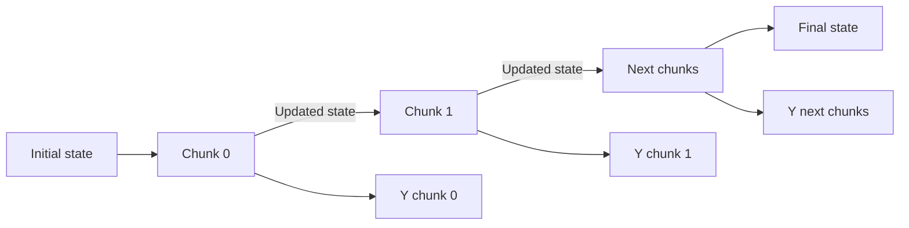
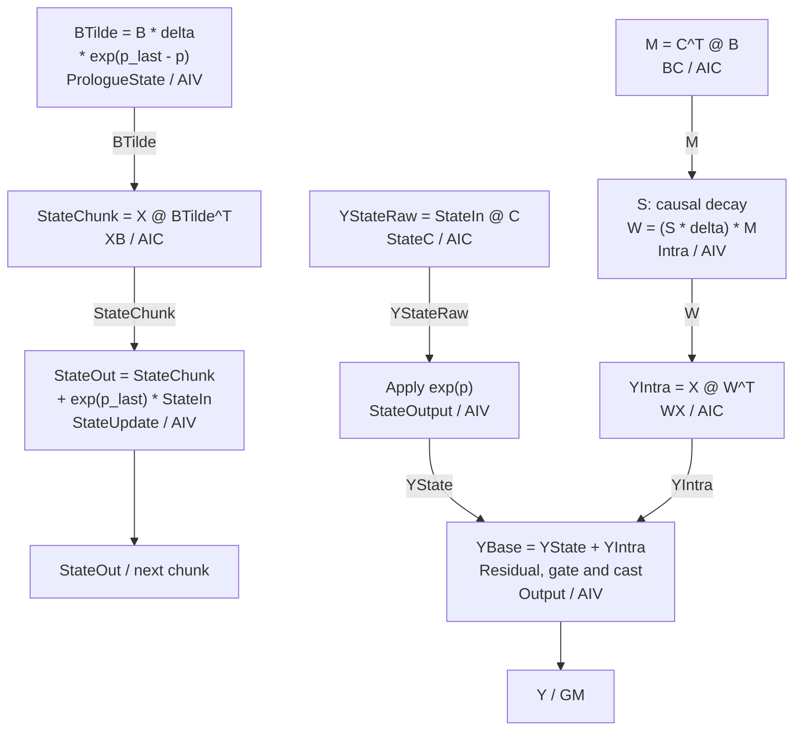

# Ascend 950 Mamba2SSD 算子设计方案

## 一、设计概述

Mamba2SSD 通过状态矩阵汇总历史输入。序列按固定长度的 chunk 划分，chunk 内通过矩阵乘并行计算各 token 的输出，chunk 之间依次传递更新后的状态。固定 chunk 长度、通道数和状态维度后，计算量随序列长度线性增长，递推状态的大小保持不变。

本方案面向 Ascend 950，主计算使用一次 `MIX_AIC_1_2` Kernel launch。每个核组由一个 AIC 和两个 AIV 协作，AIC 完成四次矩阵乘，AIV 完成衰减系数计算、状态更新和输出处理。支持 `fp16`、`bf16`、非零初态、D 残差、Z 门控和逐 chunk 状态输出。

## 二、原型设计

本文用 `Bsz` 表示 batch 数，`EH` 表示 head 数，`G` 表示系数张量 `B`、`C` 的分组数，`NC` 表示 chunk 数。chunk 长度 `L` 固定为 128，每个 head 的通道数 `P` 固定为 64，状态维度 `N` 固定为 128。

GM 张量按下表维序存储，最右侧维度连续。`EH` 必须能被 `G` 整除，每组连续的 `EH / G` 个 head 共享一组 `B`、`C`，各 head 的输入、步长和状态独立。

| 张量 | 方向 | Shape | 类型 | 含义 |
|---|---|---|---|---|
| `x` | 输入 | `[Bsz,EH,P,NC,L]` | `fp16` / `bf16` | 序列输入 |
| `B`、`C` | 输入 | `[Bsz,G,N,NC,L]` | `fp16` / `bf16` | 状态写入系数、状态读出系数 |
| `delta` | 输入 | `[Bsz,EH,NC,L]` | `fp16` / `bf16` | 每个 token 的离散步长 |
| `cumsumDelta` | 输入 | `[Bsz,EH,NC,L]` | `fp32` | 每个 chunk 内 `A * delta` 的前缀和，包含当前位置 |
| `D` | 可选输入 | `[EH,1]` 或 `[EH,P]` | `fp16` / `bf16` | 按 head 或按通道提供的残差系数 |
| `Z` | 可选输入 | `[Bsz,EH,P,NC,L]` | `fp16` / `bf16` | SiLU 门控输入 |
| `initialState` | 可选输入 | `[Bsz,EH,P,N]` | `fp16` / `bf16` | 第一个 chunk 的输入状态 |
| `y` | 输出 | `[Bsz,EH,P,NC,L]` | `fp16` / `bf16` | 序列输出 |
| `intermediateStates` | 可选输出 | `[Bsz,EH,NC,P,N]` | `fp16` / `bf16` | 每个 chunk 更新后的状态 |
| `fState` | 输出 | `[Bsz,EH,P,N]` | `fp16` / `bf16` | 最后一个 chunk 更新后的状态 |

当前入口统一选择 `fp16` 或 `bf16` 作为输入、输出和外部状态类型。`NC` 为正整数，只处理完整 chunk。

`cumsumDelta` 在主 Kernel 外生成，每个 chunk 独立累加，`A` 不作为主 Kernel 的独立输入。

## 三、计算公式

### 3.1 单 token 状态递推

以下固定一个 batch 和一个 head，chunk 内 token 从 1 编号到 `L`。令输入向量为 $x_t\in\mathbb{R}^{P}$，状态写入和读出向量分别为 $b_t,c_t\in\mathbb{R}^{N}$，步长为 $\Delta_t$，状态矩阵为 $H_t\in\mathbb{R}^{P\times N}$。

$$
\alpha_t=\exp(A\Delta_t),\qquad
U_t=\Delta_t x_t b_t^{\mathsf T},\qquad
H_t=\alpha_t H_{t-1}+U_t.
$$

`A` 是当前 head 的状态衰减参数，$U_t$ 是当前 token 写入状态的贡献，状态读出为 $H_t c_t$。

令 $H_0=H_{\mathrm{in}}$ 为传入当前 chunk 的状态，定义前缀和：

$$
p_0=0,\qquad p_t=\sum_{k=1}^{t}A\Delta_k.
$$

$p_t$ 对应输入 `cumsumDelta`。$\exp(p_t)$ 表示 chunk 输入状态衰减到 token $t$ 的系数；$\exp(p_t-p_j)$ 表示 token $j$ 的写入衰减到 token $t$ 的系数。

### 3.2 Chunk 输出

将当前 chunk 的输入按列组成矩阵 $X\in\mathbb{R}^{P\times L}$、$B,C\in\mathbb{R}^{N\times L}$。输出分为历史状态读出 `YState` 和当前 chunk 内输入读出 `YIntra`：

$$
Y_{\mathrm{state}}[:,t]=\exp(p_t)H_{\mathrm{in}}c_t,
\qquad
Y_{\mathrm{intra}}[:,t]=\sum_{j=1}^{t}\exp(p_t-p_j)U_jc_t.
$$

`YState` 只包含传入状态的贡献。`YIntra` 包含本 chunk 内自身及之前 token 的写入贡献，每次写入都计入到当前位置的衰减。

为并行计算 `YIntra`，先构造 token 间的相关矩阵和因果衰减矩阵：

$$
M=C^{\mathsf T}B,\qquad
S_{ij}=\begin{cases}
\exp(p_i-p_j), & j\le i,\\
0, & j>i,
\end{cases}
\qquad W_{ij}=M_{ij}\bigl(S_{ij}\Delta_j\bigr).
$$

$M$、$S$、$W$ 的形状均为 $L\times L$。行索引 $i$ 表示输出 token，列索引 $j$ 表示写入 token，步长沿列方向缩放。随后计算：

$$
Y_{\mathrm{intra}}=XW^{\mathsf T},\qquad
Y_{\mathrm{stateRaw}}=H_{\mathrm{in}}C,\qquad
Y_{\mathrm{state}}[:,t]=\exp(p_t)Y_{\mathrm{stateRaw}}[:,t].
$$

三者的形状均为 $P\times L$。记当前 head 的残差系数为 $d$，门控向量为 $z_t$，最终输出为：

$$
y_t=\bigl(Y_{\mathrm{state}}[:,t]+Y_{\mathrm{intra}}[:,t]+d\odot x_t\bigr)
\odot\operatorname{SiLU}(z_t).
$$

$\odot$ 表示逐元素乘法。按 head 提供的 `D` 广播到全部通道，按通道提供时逐通道使用。关闭 `D` 时省略残差项，关闭 `Z` 时省略 SiLU 门控。

### 3.3 Chunk 状态更新

传给下一 chunk 的状态需要汇总当前 chunk 的全部写入，并将它们衰减到 chunk 末尾：

$$
\widetilde B[:,j]=B[:,j]\Delta_j\exp(p_L-p_j),\qquad
\mathrm{StateChunk}=X\widetilde B^{\mathsf T},
$$

$$
H_{\mathrm{out}}=\exp(p_L)H_{\mathrm{in}}+\mathrm{StateChunk}.
$$

$\widetilde B$ 的形状为 $N\times L$，`StateChunk` 和输出状态的形状均为 $P\times N$。`StateChunk` 只包含当前 chunk 的写入，更新后的完整状态继续传给下一 chunk：

## 四、算子方案设计

### 4.1 组件与执行流程

方案沿用 CATLASS 的 Kernel、Block、Tile 分层。Host 准备参数和输入，launch 层选择数据类型与功能开关；Kernel 负责片上空间、任务调度、状态初始化和 chunk 循环。矩阵乘和状态前处理位于 `Gemm::Block`，向量后处理位于 `Epilogue::Block`。所有 Block 共享同一个 `Arch::Resource`，矩阵乘与数据搬运复用 CATLASS 的 Tile 组件。

下图展示各 Block 的计算关系与 AIC/AIV 分工，`BTilde` 对应公式中的 $\widetilde B$。

图中的 `p` 表示输入前缀和 `cumsumDelta`，`p_last` 表示其末项，`@` 表示矩阵乘，`*` 表示按相应维度广播的逐元素乘法。

AIC 按 BC、StateC、WX、XB 的顺序执行，AIV 按 Intra、PrologueState、StateOutput、StateUpdate、Output 的顺序执行。

### 4.2 任务调度与 Tile 配置

最小任务单元为一个 batch 下的一个 head。Host 根据任务数和 AIC 数量确定启动规模，各核组按固定步长领取任务。同一 head 的全部 chunk 由同一个核组顺序处理，使递推状态能够跨 chunk 保留在片上。

矩阵乘 Tile 配置如下，`M`、`N`、`K` 分别表示输出行数、输出列数和归约维度。

| Block | M | N | K | 每个 AIV 接收的结果形状 |
|---|---:|---:|---:|---|
| BC | 128 | 128 | 128 | `[64,128]` |
| StateC | 64 | 128 | 128 | `[32,128]` |
| WX | 64 | 128 | 128 | `[32,128]` |
| XB | 64 | 128 | 128 | `[32,128]` |

两个 AIV 按行分工，各自处理 `W` 的 64 个 token 行、`BTilde` 的 64 个状态维度，以及输出和状态的 32 个通道。

### 4.3 片上资源与同步

`B`、`C`、`X` 使用 L1 双缓冲，计算当前 chunk 时预取下一 chunk 的输入。`C` 供 BC 和 StateC 共用，`X` 供 WX 和 XB 共用。

`fp32` state 跨 chunk 常驻 UB，`YState` 和 `YIntra` 保留到当前 chunk 的输出合并完成。

矩阵乘结果从 L0C 按行分发到两个 AIV 的 UB。AIV 生成的 `W`、`BTilde` 和低精度状态经 UB 搬入 L1，供后续矩阵乘读取。AIC/AIV 通过数据就绪和缓冲区释放信号交接，保证读取前数据完整、覆盖前消费完成。

### 4.4 状态与精度处理

每个 head 从 `initialState` 开始递推，未提供初态时使用零状态。

四次矩阵乘使用 `fp16` 或 `bf16` 操作数、`fp32` 累加，向量中间计算和递推状态使用 `fp32`。`W`、`BTilde` 和送入 StateC 的状态在矩阵乘前转换为低精度。

StateUpdate 更新 `fp32` state。非末 chunk 将低精度快照送入 L1，供下一 chunk 的 StateC 读出。状态递推始终使用 UB 中的 `fp32` 值，避免将快照的舍入误差反馈到递推状态。

开启逐 chunk 状态输出时，每次更新后写入 `intermediateStates`。最后一个 chunk 写入 `fState`。
